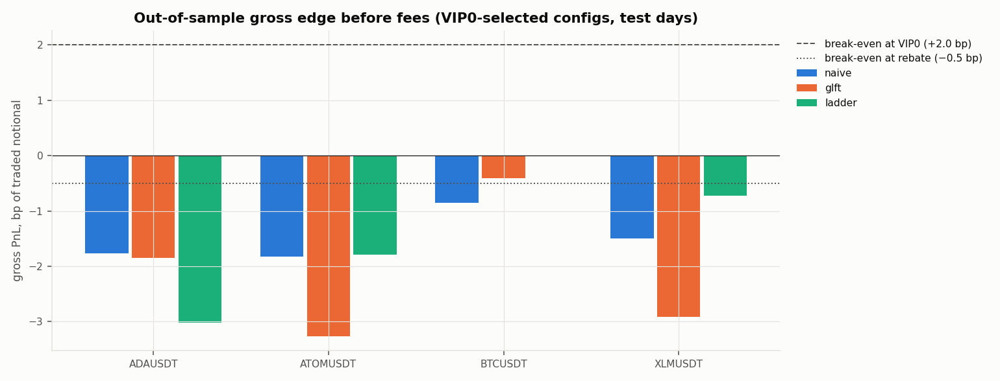
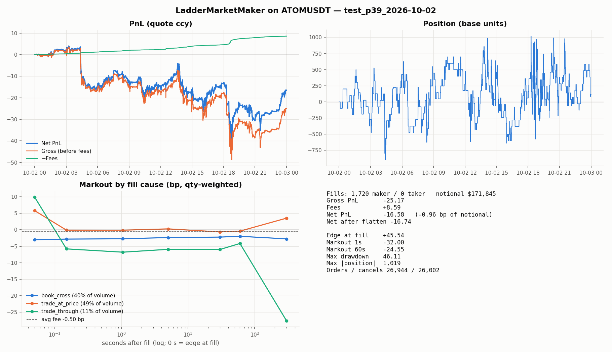

# lob-sim-cpp

[](https://github.com/saarthakg/lob-sim-cpp/actions/workflows/ci.yml)

A **C++ limit-order-book engine and market-making research platform**:
event-driven replay of full exchange order books, a matching simulator with an
explicit queue-position model and three latency channels, literature-based
market-making strategies, and a research workflow built so it can't fool
itself. It runs entirely on **free public data**.

| | |
|---|---|
| **Speed** | Order-level (L3) book at **50M msgs/s, 18 ns p50 / 46 ns p99 per operation**, 5× a `std::map`/`std::list` book. A **full Nasdaq ITCH 5.0 day** (268.7M messages, 8,892 symbols) rebuilds every order book in 22 s of compute. **Live tick-to-trade of 8.2 µs p50 / 22 µs p99** on Bybit's real-time feed (WebSocket thread → lock-free ring → engine). |
| **Fidelity** | On order-level data, our simulated orders sit in the **real FIFO queue**. Against independent L3 ground truth the exact-queue exchange matches real fills with 0.996 accuracy and 1.000 precision. On L2-only data, a queue model is used instead; it is calibrated against the same ground truth (fill rates within 3%). Feed, order-entry and response latency are modelled separately, so stale quotes really do get picked off. |
| **Rigour** | Walk-forward parameter selection; 16 out-of-sample days; sensitivity sweeps over latency, queue model and fill rule; and a **pre-registered** confirmation test on 30 untouched days. CI on GCC, Clang and AppleClang, with ASan/UBSan and TSan jobs. |

**What the platform found** ([Results](#results)):

- **The strategies work as designed and the research features pay off.**
  GLFT and a queue-priority ladder, with an out-of-sample-fitted book-imbalance
  alpha and a trade-driven depletion guard, cut losses 85–99% versus naive
  quoting. They also raise the spread captured at fill from negative to
  +0.5–7 bp.
- **The imbalance signal is real.** Correlation with 1–5 s returns is 0.13–0.34
  out of sample, and on BTC it is profitable before costs when trading on it as a
  taker.
- **Passive execution beats crossing the spread** by 1.8 bp per parent order,
  on every test day.
- **Retail-latency market making is still not profitable.** Adverse selection
  outweighs the spread captured at every fee tier tested, including a maker
  rebate. The platform quantifies the gap: how much edge, how fast a reaction
  and what fee tier it would take.
- **A promising pattern failed its pre-registered test.** This is exactly
  the kind of false positive the workflow is built to catch.

> The pre-overhaul version of this README reported market-making profits. Those
> came from a fill model that could not fill a resting order honestly, a
> replay that began from an empty book, and Binance "bookDepth" files that are
> not order-book data at all. See [What changed](#what-changed-and-why) for
> the full list.

---

## Contents

- [Quickstart](#quickstart)
- [Order-level (L3) engine](#order-level-l3-engine)
- [Nasdaq ITCH 5.0 replay](#nasdaq-itch-50-replay)
- [Live paper-trading runtime](#live-paper-trading-runtime)
- [How the simulator works](#how-the-simulator-works)
- [Strategies](#strategies)
- [Research workflow](#research-workflow)
- [Results](#results)
- [What changed and why](#what-changed-and-why)
- [Limitations](#limitations)
- [Sources](#sources)

---

## Quickstart

```bash
# build (macOS: if the system CLT is broken, use Homebrew LLVM — see docs/architecture.md)
cmake -B build -DCMAKE_BUILD_TYPE=Release -G Ninja
cmake --build build -j
./build/lob_tests                                   # 89 test cases

# data: one day of Bybit BTCUSDT book (~200 MB) + trades (~12 MB)
python3 -m venv python/.venv && python/.venv/bin/python -m pip install -r python/requirements.txt
python/.venv/bin/python python/data/download_bybit.py --symbol BTCUSDT --start 2026-10-03 --end 2026-10-03

# profile the market: spread distribution and whether passive quoting can pay its fees
./build/lob_sim --stats data/raw/bybit/2026-10-03_BTCUSDT_ob200.data.zip \
                --trades data/raw/bybit/BTCUSDT2026-10-03.csv.gz

# backtest the GLFT market maker with a 5 ms one-way latency
./build/lob_sim --replay data/raw/bybit/2026-10-03_BTCUSDT_ob200.data.zip \
                --trades data/raw/bybit/BTCUSDT2026-10-03.csv.gz \
                --strategy glft --order-size 0.01 --max-position 0.1 \
                --latency-us 5000 --output data/processed/glft_demo
python/.venv/bin/python python/analysis/run_report.py --run data/processed/glft_demo --save
```

The order-level engine, ITCH replay and live runtime:

```bash
./build/lob_bench_l3                                # L3 book vs std::map/std::list book

# record Bitstamp's public order-level feed, convert, replay with exact queue priority
python/.venv/bin/python python/data/capture_bitstamp_l3.py --pairs btcusd --minutes 30
./build/lob_sim --convert-bitstamp-l3 data/raw/bitstamp/<capture>.l3.jsonl --output btc.l3bin
./build/lob_sim --replay-l3 btc.l3bin                               # book-only throughput + consistency
./build/lob_sim --replay btc.l3bin --strategy naive --quote-on-book # exact-queue backtest

# a full Nasdaq day (free sample: emi.nasdaq.com/ITCH/Nasdaq ITCH/12302019.NASDAQ_ITCH50.gz)
./build/lob_sim --replay-itch 12302019.NASDAQ_ITCH50.gz --snapshot-time 10:30:00 --symbols AAPL,MSFT

# live paper trading on Bybit's real-time feed, with latency percentiles
./build/lob_sim --live bybit --symbol BTCUSDT --minutes 10 --strategy naive \
                --order-size 0.001 --max-position 0.01 --quote-on-book
```

Run `./build/lob_sim --help` for every option: fees (negative = rebate), queue
model, exchange model, the fill-model bracket, per-channel latency and jitter,
and strategy parameters.

---

## Order-level (L3) engine

`L3Book` is a full order-level book with strict price-time priority, built
for replaying an exchange's raw order feed.

```
 order id ──FlatHashMap──▶ pool index ──▶ Order {prev,next,level}  ◀── intrusive FIFO per price level
                                                 │
 price ──PriceLadder (bitmap window + overflow)──▶ Level {head,tail,total,count}
```

| Design choice | Why |
|---|---|
| Orders in an index-based `ObjectPool`, linked into intrusive doubly linked FIFOs | O(1) add, cancel, modify and execute, with no search inside a level; 32-bit links keep orders dense; no malloc once warmed up |
| `FlatHashMap` (open addressing, linear probing, backward-shift deletion) for order id → order | One or two cache lines per lookup; no tombstones, so probe lengths don't degrade under real feeds where most orders are cancelled |
| `PriceLadder`: a dense price window with a two-level occupancy bitmap, plus a map for far prices | Finding the next best price after the touch empties is a couple of `ctz`/`clz` instructions, not a tree walk; the window recentres when the market drifts |

**Correctness.** A 300k-operation randomized differential test checks every
step against a `std::map`/`std::list` reference book, including identical
maker fill sequences from `match()`. Tests: `cpp/tests/test_l3_book.cpp`.

**Speed** (`lob_bench_l3`, 5M-message order-level stream: 50% add, 40%
cancel, executes and sweeps; ~20k resting orders; Apple M-series):

| Book | Throughput | p50 | p90 | p99 | p99.9 |
|---|---|---|---|---|---|
| **L3Book** | **50.1M msg/s** | **18 ns** | **23 ns** | **46 ns** | **143 ns** |
| `std::map` + `std::list` + `std::unordered_map` | 10.4M msg/s | 91 ns | 109 ns | 189 ns | 323 ns |

**Real exchange data.**
- `python/data/capture_bitstamp_l3.py` records Bitstamp's public order-level
  feed; `lob_sim --convert-bitstamp-l3` turns it into a fixed-record binary
  format (`.l3bin`).
- `lob_sim --replay-l3` replays it.
- 150 minutes of BTC/USD (954k events) replays at **24M records/s**, with zero
  unknown order references.

**Exact-queue exchange.** On `.l3bin` data the backtester uses
`L3ExchangeSim`. Our orders are inserted into the real FIFO, so every later
market order queues behind us and every cancel ahead moves us up. A trade
print fills us exactly when the matching engine would have reached our order
before the real maker. Scored against the independent L3 ground truth
(`python/analysis/queue_model_validation.py`):

| BTC/USD, 60 s horizon (63% of fills queue-driven) | Fill rate (true 0.305) | Accuracy | Precision |
|---|---|---|---|
| **Exact-queue L3 exchange** | **0.300** | **0.996** | **1.000** |
| Best L2 queue model (Power-2) | 0.296 | 0.965 | 0.957 |
| Log queue model | 0.392 | 0.889 | 0.747 |

Every strategy runs unchanged on both data paths, and `--exchange-model l2`
scores the queue model on the same L3 market for a direct comparison
([results/l2_vs_l3/COMPARISON.md](results/l2_vs_l3/COMPARISON.md)). Running
naive, ladder and GLFT strategies on 150 minutes of Bitstamp BTC, ETH and XRP
under both exchanges:

- **Fill counts.** The queue model's fills are −4% to +48% off the
  exact-queue fills. XRP touch-joining strategies are over-filled by about
  45%.
- **Gross edge.** It is misstated by up to 0.8–1.5 bp in either direction,
  the same order of magnitude as maker fees and as the edge being measured.
- **What survives.** Every configuration is negative under both exchanges, so
  the conclusions hold. But the size of a market maker's edge can only be
  trusted with exact queue priority.

---

## Nasdaq ITCH 5.0 replay

`itch::parse_itch` is a zero-copy decoder for Nasdaq TotalView-ITCH 5.0,
the binary order-level feed of every Nasdaq-traded stock.

- **Decoding.** Length-framed, big-endian messages are decoded in place and
  dispatched to a templated handler: no virtual calls and no copies.
- **Books.** `ItchBookBuilder` keeps one `L3Book` per symbol.
- **Prices** use an exact, order-preserving piecewise scale: 1/10,000 USD
  below $1, cents at or above $1. Sub-penny quotes are legal only below $1
  (Reg NMS Rule 612), and the rule depends on the *order's* price, not the
  stock's, so a $0.0001 stub bid on a $12 stock is kept exactly.

**Nasdaq's free 2019-12-30 sample day** (8.25 GB uncompressed,
[results/itch/2019-12-30_replay.txt](results/itch/2019-12-30_replay.txt)):

| | |
|---|---|
| Messages | 268.7M: 118.6M adds, 114.4M deletes, 21.6M replaces, 5.8M executions, 2.8M partial cancels |
| Books | 8,892 symbols, every one empty at end of feed (as it should be after the close) |
| Consistency | 0 unknown order refs, 0 duplicate adds, 0 over-executions, 0 sub-penny prices ≥ $1 |
| Compute (decode + book updates) | 21.7 s, i.e. **12.4M msgs/s (81 ns/msg)** |
| End to end incl. disk | 24.0 s (11.2M msgs/s) |

The full-market rate is below the single-book benchmark (18 ns/op). The
profile shows the time spread across the book operations rather than any one
hotspot: each message lands on a random one of ~9k books, so the working set
far exceeds the CPU caches and the cost is memory latency.

The results file includes a 10:30 snapshot of the AAPL, MSFT, AMZN, TSLA and
QQQ books, for example AAPL $286.37 × $286.40 and MSFT $157.11 × $157.12:
plausible levels for those names in late December 2019, built purely from
order messages.

---

## Live paper-trading runtime

`lob_sim --live bybit --symbol BTCUSDT --strategy <s> --quote-on-book` runs
any strategy against Bybit's **real-time** public feed, with orders matched by
the simulated exchange. It needs no account and no API keys, and it uses the
same `Backtester`, strategies and exchange as a backtest; only the
`EventSource` changes.

```
 WebSocket thread                                    engine thread
 frame ─▶ stamp recv time ─▶ fixed-point parse ─▶ SpscRing ─▶ exchange sim ─▶ strategy ─▶ order
                                                 lock-free       ↑ recv→engine    ↑ engine→trade
                                                 SPSC ring       └──────── tick→trade ────────┘
```

| Piece | Design |
|---|---|
| Hand-off | Lock-free SPSC ring: cache-line-separated head and tail, each side caching the other's index, acquire/release only. ThreadSanitizer-clean under a 5M-message two-thread test. |
| Parsing | The same allocation-light fixed-point parser as the historical archive (the archive stores the WebSocket messages verbatim). |
| Flow control | Backpressure, never drops, since a lost delta corrupts the book. Reconnects resubscribe and arrive as a fresh snapshot. |
| Measurement | Every frame is stamped on arrival. Receive→engine, engine→trade and tick→trade are recorded for every order or cancel sent *in reaction to* an event, with a 1 s start-up warm-up excluded. |

**10 minutes live, BTCUSDT** (`orderbook.50` + `publicTrade`, laptop, no core
pinning; 20k events, zero ring overruns):

| Stage | p50 | p90 | p99 | p99.9 |
|---|---|---|---|---|
| Parse (WebSocket thread) | 1.6 µs | — | 6.4 µs | — |
| Receive → engine (through the ring) | 2.6 µs | 6.1 µs | 37.5 µs | 818 µs |
| Engine → order (exchange sim + strategy) | 3.2 µs | 6.5 µs | 12.9 µs | 14.1 µs |
| **Tick → trade** (frame received → order sent) | **8.2 µs** | **14.8 µs** | **22.2 µs** | **25.4 µs** |

**Profiling.** `--measure-latency` replays an archive while timing the same
engine path, so it can be profiled reproducibly. The profile showed the
`std::map` L2 book plus a per-event hash map dominating. Rebuilding the L2
book on the bitmap price ladder cut engine compute on a full BTCUSDT day from
**25.7 µs to 3.1 µs at p50** and from **103 µs to 8.9 µs at p99**, and live
tick-to-trade from 16.4 µs to 8.2 µs, with backtest results bit-identical.

The remaining p99.9 tail on receive→engine is OS scheduling on a laptop.
Core pinning and a busy-polling socket would be the next steps on a
dedicated host.

---

## How the simulator works

```
 Bybit ob200 (.zip) ─┐                      exchange time                         local (strategy) time
 Bybit trades (.gz) ─┼─▶ EventSource ─▶ book ─▶ ExchangeSim ─┬─ feed_us ────▶ local book ─▶ Strategy
 v2 live capture  ───┘   merge by       (true)   queue model  │                              │
                         engine time             fills, fees  ◀── entry_us (orders, cancels) ─┘
                                                 Portfolio   ── response_us (fills, acks) ──▶ local position
```

| Concern | What the simulator does |
|---|---|
| **Data** | Bybit `orderbook.200`: a snapshot, then 100 ms deltas. The book is stamped with matching-engine time (`cts`), and trade prints are merged in *before* the book update that reflects them. Tick and lot are auto-detected. RPI prints are dropped. [docs/dataset.md](docs/dataset.md) |
| **Passive fills** | Our order joins the back of the displayed queue. It fills from prints at its price (only after the queue ahead is consumed; partial fills allowed), from prints *through* its price, or when the opposite quote crosses it. Depth decreases not explained by trades are cancellations, split between ahead of and behind us by a RiskAverse / Power(n) / Log queue model, after [hftbacktest](https://hftbacktest.readthedocs.io/en/latest/order_fill.html). [docs/assumptions.md](docs/assumptions.md) |
| **Latency** | Three channels. **Feed:** the strategy sees a delayed book. **Entry:** orders *and cancels* land late, so stale quotes get picked off and late cancels come back `CancelRejected`. **Response:** the strategy's view of its own position lags. Optional lognormal jitter. |
| **Orders** | Post-only, GTC, IOC and market. A local gateway refuses self-crosses and position-limit breaches. Maker and taker fees are separate; negative fees are rebates. |
| **Attribution** | Every fill records the mid at fill and at +0.1 s, 1 s, 5 s, 30 s, 60 s and 300 s. `edge` is the spread captured at the fill instant; markout minus edge is adverse selection; gross PnL in bp of notional is the break-even maker fee. Also reported: net PnL after the cost of flattening, drawdown, inventory and quote uptime. |
| **Speed** | L2 book updates: 33M/s (20 levels) and 62M/s (200 levels) on the bitmap price ladder, versus 12M/s and 8M/s for the original `std::map` book. Full backtest loop with a strategy: 5.7–6.2M events/s (`lob_bench`, synthetic). A real BTCUSDT day (860k book updates, 320k trades) replays in about 2.5 s from the compressed files; decompression and parsing are now the bottleneck. |

---

## Strategies

| Strategy | Idea | Source |
|---|---|---|
| `naive` | Join the best bid and ask; stop at a position limit. The control. | — |
| `glft` | Closed-form optimal quotes with inventory skew. **σ** and fill intensity **λ(δ) = A·e^(−kδ)** are re-fitted every 5 s on a rolling 10-minute window of trades. The maker fee is added to quote depth. **Alpha:** an imbalance/microprice term shifts the fair price, with coefficients fitted on training days. Grid levels keep queue priority, and a depletion guard pulls a touch quote as soon as prints show its level being swept. | Guéant, Lehalle & Fernandez-Tapia (2013); hftbacktest GLFT and OBI tutorials; Stoikov (2018) |
| `ladder` | For **large-tick** books (spread pinned at 1 tick, tick ≫ fee). Rest a ladder from the touch to N ticks behind it so the orders hold queue priority when price arrives. Pull only the touch order, and only when the imbalance alpha or trade-driven depletion says the level is about to break. | Moallemi & Yuan (queue value); Cont, Kukanov & Stoikov (2014) |
| `imbalance` | Taker: cross the spread on extreme touch imbalance, exit after 5 s. Measures whether the signal can pay a taker fee. | Cont et al. (2014) |
| `twap` | Execute a parent order in time slices, either crossing each slice immediately or posting it passively and sweeping the remainder. | — |
| `probe` | Never-cancelled one-lot orders at scheduled points, used to score the fill model against L3 truth. | — |

---

## Research workflow

The process follows the [research notes](docs/research_notes.md).

1. **Choose markets by arithmetic before backtesting.** `lob_sim --stats` across
   24 liquid Bybit perpetuals (2026-10-01):

   | Symbol | 1 tick | Spread − 2 × VIP0 maker fee |
   |---|---|---|
   | BTCUSDT | 0.012 bp | −3.99 bp |
   | ETHUSDT | 0.037 bp | −3.96 bp |
   | SOLUSDT | 0.85 bp | −3.15 bp |
   | **ADAUSDT** | **4.1 bp** | **+0.04 bp** |
   | **XLMUSDT** | **4.6 bp** | **+0.50 bp** |
   | **ATOMUSDT** | **5.9 bp** | **+2.02 bp** |

   On 21 of the 24 symbols, BTC and ETH included, a maker round trip at VIP0
   (2 bp + 2 bp) costs more than the quoted spread *before* any adverse
   selection. The study uses BTCUSDT, the most liquid control, and the three
   large-tick contracts.

2. **Fit signals out of sample.** `signal_research.py` regresses 1 s, 5 s and
   30 s mid moves on the weighted-mid offset and depth imbalance. Coefficients
   are fitted on days 1–4 and scored on days 5–8.

   | Symbol | OOS correlation with the 5 s move (4 test days) |
   |---|---|
   | BTCUSDT | 0.13 – 0.18 |
   | ATOMUSDT | 0.17 – 0.25 |
   | ADAUSDT | 0.15 – 0.29 |
   | XLMUSDT | 0.29 – 0.34 |

   The signal is real and stable. Its *size* is the issue: a fraction of a
   tick on large-tick books.

3. **Walk-forward.** For every symbol × strategy × maker-fee tier (+2.0 bp
   VIP0, 0 bp, −0.5 bp rebate):
   - **Grid-search** parameters on 4 training days (2026-09-28 → 10-01).
   - **Run** the selected parameters once on 4 untouched test days
     (10-02 → 10-05).
   - **Report** only test days. Training winners routinely decayed on test;
     for example, ATOM GLFT went from +$1.16/day on training to −$16.81/day
     on test.

4. **Stress the selection.** Latency from 0 to 200 ms; queue models
   RiskAverse and Log; the optimistic no-cross-fill bracket.

5. **Validate the fill model** against order-level ground truth
   ([Queue-model validation](#queue-model-validation)).

Reproduce everything:

```bash
python python/experiments/study.py              # ~45 min on 10 cores
python python/experiments/study.py --extended   # stage 2: grids extended where stage 1 hit a boundary
python python/experiments/summarize_study.py    # -> results/study/SUMMARY.md, docs/plots/study_*.png
```

---

## Results

All numbers are **out of sample**: Bybit USDT perpetuals, 4 test days,
parameters chosen on 4 earlier days. Order sizes are a few hundred dollars.
Full tables:
- [results/study/SUMMARY.md](results/study/SUMMARY.md)
- [results/taker/SUMMARY.md](results/taker/SUMMARY.md)

### 1. Market making: no configuration is reliably profitable at any fee tier

Selected configuration per cell. Net PnL is $/day averaged over test days;
**gross bp** is PnL before fees in bp of traded notional, which is also the
maker fee at which that configuration would break even.

| | VIP0 (+2 bp maker) | 0 bp | Rebate (−0.5 bp) | Gross bp (break-even fee) | Edge at fill → 5 s markout (bp) |
|---|---|---|---|---|---|
| BTCUSDT naive | −11,949 | −3,576 | −1,482 | −0.85 | −0.20 → −0.83 |
| BTCUSDT GLFT | −26 | −97 | −68 | −0.41 … −0.74 | +0.35 → −0.70 (rebate) |
| ATOMUSDT naive | −480 | −229 | −166 | −1.83 | −0.40 → −1.98 |
| ATOMUSDT GLFT | −17 | −11 | −11 | −2.1 … −3.3 | +4.1 → −2.2 (rebate) |
| ATOMUSDT ladder | −65 | −31 | −22 | −1.79 | +2.8 → −2.0 |
| XLMUSDT naive | −1,245 | −533 | −356 | −1.50 | −0.72 → −1.65 |
| XLMUSDT GLFT | −16 | −15 | **+1.5** (2/4 days) | −0.32 … −2.9 | +3.0 → −0.50 (rebate) |
| XLMUSDT ladder | −38 | −9 | −1.1 (2/4 days) | −0.57 … −0.73 | +2.0 → −0.36 |
| ADAUSDT naive | −1,638 | −769 | −552 | −1.77 | −0.54 → −1.80 |
| ADAUSDT GLFT | −47 | −42 | −37 | −1.65 … −2.4 | +2.0 → −2.0 (rebate) |
| ADAUSDT ladder | −249 | −149 | −125 | −3.01 | +0.55 → −1.92 |



**Stage 2: extending the grids where stage 1 hit a boundary.** GLFT always
picked the widest half-spread multiplier and the ladder the strongest alpha,
so both grids were extended (half-spread up to 8×, alpha up to 5×) under the
same split.

- **Training days improved.** The best wide-quote GLFT configurations earned
  +$15 to +$21/day on the training days.
- **Test days did not.** Daily test PnL is indistinguishable from zero:

  | Config (stage 2, selected on training days) | Test-day net PnL, $/day | Mean | t-stat |
  |---|---|---|---|
  | BTCUSDT GLFT, rebate, half-spread 8× | −15.8, +7.7, −2.7, +28.5 | +4.4 | 0.47 |
  | XLMUSDT GLFT, VIP0, half-spread 8× | +34.3, −4.8, −4.4, +9.4 (5–14 fills/day) | +8.7 | 0.94 |
  | ADAUSDT GLFT, rebate, half-spread 8× | −11.9, −3.9, −25.7, +76.0 | +8.6 | 0.38 |
  | ATOMUSDT GLFT, VIP0, half-spread 3× | −41.7, +37.8, −54.3, +25.1 | −8.3 | −0.36 |

- **Why:** quoting very wide means only being filled on overshoots. That is a
  low-frequency bet on short-term mean reversion, not market making. With so
  few fills, any single day is a coin flip.
- **More test days:** see [Pooled out-of-sample](#pooled-out-of-sample-16-days).

#### Pooled out-of-sample (16 days)

**Method.** Four test days can reject a strategy that loses every day. They
cannot tell a small edge from zero. So every selected GLFT and ladder
configuration was re-run, parameters frozen, on 12 more days that were never
used for selection (2026-09-16 → 09-27), and pooled with the 4 test days
([results/study/EXTRA_OOS.md](results/study/EXTRA_OOS.md)).

**Ordinary market making is decisively negative.**

| Config | $/day | t-stat | Days > 0 |
|---|---|---|---|
| BTCUSDT GLFT, rebate | −77.5 | −10.7 | 0 of 16 |
| ATOMUSDT ladder, VIP0 | −86.1 | −8.0 | 0 of 16 |
| ADAUSDT ladder, VIP0 | −181.3 | −6.9 | 0 of 16 |
| XLMUSDT ladder, VIP0 | −62.1 | −3.1 | 4 of 16 |

Every touch-based configuration has a negative mean.

**Wide-quote GLFT is the one recurring positive.** These configurations quote
2–8× the GLFT half-spread and fill only on overshoots.

| Symbol | VIP0 $/day (t) | Rebate $/day (t) | Fills/day |
|---|---|---|---|
| ADAUSDT | +22.4 (t = 2.28, 69% of days) | +14.8 (t = 2.35) | 120–290 |
| ATOMUSDT | +2.9 (0.42) | +8.3 (1.22) | 170–340 |
| XLMUSDT | +7.8 (1.88) | +4.9 (0.75) | 19–1,100 |
| BTCUSDT | −1.7 (−0.43) | +1.2 (0.23) | 80–215 |

About 28 configurations were examined to get here, so one or two
|t| > 2 cells are expected by chance. The pattern is coherent and economically
plausible: providing liquidity only into dislocations earns a reversal
premium (Nagel 2012). But it is a *hypothesis*, so it got a pre-registered
test.

#### Pre-registered confirmation test (30 fresh days)

[results/PREREGISTRATION.md](results/PREREGISTRATION.md) was committed and
pushed *before* the confirmation data was downloaded. It fixes:
- the eight configurations, with every parameter frozen;
- a 30-day window, 2026-08-17 → 09-15, never touched before;
- the pass/fail rules. The primary criterion is a daily ADA+ATOM+XLM
  portfolio at VIP0 with t > 2 and more than half of days positive. Any
  per-configuration claim needs t > 2.7 (Bonferroni).

**Result: H1 not supported**
([results/confirmation/CONFIRMATION.md](results/confirmation/CONFIRMATION.md)).

| Pre-registered criterion | Mean $/day | t-stat | Days > 0 | Verdict |
|---|---|---|---|---|
| Primary: ADA+ATOM+XLM, VIP0 | +2.80 | +0.31 | 53% | not supported |
| Secondary: ADA+ATOM+XLM, rebate | −5.67 | −0.74 | 57% | not supported |

- **No single configuration came close to t > 2.7.** The best was ATOM at the
  rebate tier, t = +0.79.
- **ADAUSDT, the strongest candidate (t = 2.3 over 16 days), went to −$1.49/day
  (t = −0.17) on fresh data.**
- **What the wide-quote "edge" was:** selection noise across about 28
  configurations, exactly what the multiple-comparisons warning predicted.
  The pre-registration is what kept it from being reported as a result.

What the table shows:

- **Every gross bp is negative.** Every passive configuration on every symbol
  loses money *before fees* out of sample. The fee tier only decides how much
  more it loses. The one positive net cell, XLM GLFT with a rebate at
  +$1.5/day, is positive on 2 of 4 days and is noise.
- **The research ideas do help.** Imbalance alpha, fee-aware depth, the
  queue-priority ladder and the trade-driven depletion guard shrink ATOM losses
  from −$480/day (naive) to −$65/day (ladder) at VIP0, and from −$166 to −$22
  at the rebate tier. They move *edge at fill* from negative to +0.5–7 bp. And
  they were selected on training data, not by hand.
- **None of it beats adverse selection.** Within 5 seconds the mid moves
  through the fill by more than the spread captured. A resting order mostly
  fills when the market is about to move through it, and that is the
  mechanism Glosten–Milgrom and Moallemi–Yuan describe.
- **BTCUSDT cannot work for a retail participant.**
  - The spread is 0.012 bp, so a quote earns essentially nothing by sitting at the touch.
  - GLFT's fee-aware quotes sit about 170 ticks out at VIP0 and only fill on large moves.
  - At the rebate tier it quotes at the touch and loses −0.74 bp gross.

  This matches the hftbacktest author's own caveat that their positive
  results come "mainly from rebates", and that edge decayed from 0.0139%
  per trade (2023) to 0.0044% (2025).

**One out-of-sample day, dissected** (ATOMUSDT ladder, rebate tier, 2026-10-02):



- **Fills at our price after the queue ahead is consumed** (49% of volume):
  +5.8 bp at the fill, about 0 bp within 1 s.
- **Fills where the level vanished and price crossed through the order**
  (40%): about −3 bp throughout.
- **Prints through the price** (11%): −5 to −7 bp.
- **Net:** the rebate (+$8.6) doesn't cover the −$25 gross.

### 2. The result is robust to latency and fill-model assumptions, except the queue model on large-tick books

Re-running the selected configurations on test days:

| | 0 ms → 200 ms latency (gross bp) | Optimistic (no cross-fills) | Queue: RiskAverse | Queue: Log |
|---|---|---|---|---|
| BTCUSDT GLFT, VIP0 | −0.41 → −0.96 | −0.47 | −0.41 | −0.41 |
| BTCUSDT GLFT, rebate | −0.74 → −0.79 | −0.80 | −0.76 | −0.70 |
| ATOMUSDT ladder, rebate | −1.79 → −2.07 | −1.85 | −2.01 | −0.46 |
| XLMUSDT ladder, rebate | −0.57 → −0.60 | −0.48 | −0.82 | **+2.00** (+$69/day) |
| ADAUSDT ladder, rebate | −3.01 → −1.92 | −3.15 | −3.42 | −2.27 |

- **BTC is negative under every assumption.**
- **On large-tick books the queue model decides the answer.**
  - The Log model credits a near-front order with a larger share of the
    cancellations ahead of it.
  - So the order reaches the front more often, and front-of-queue fills are
    the profitable ones.
  - Under Log, the XLM ladder makes +2.0 bp gross (+$69/day at the rebate
    tier), and +1.85 bp gross even at VIP0.
- **A result whose sign flips with an unobservable modelling choice is not an
  edge.** It is a hypothesis about queue dynamics, and the next section tests
  it directly. The answer: the Log model over-fills by 31% against
  order-level ground truth, so the positive Log-model results don't hold.

### Queue-model validation

L2 data cannot show where in a queue cancellations come from, but L3 data can.

**Capture.** `capture_bitstamp_l3.py` records Bitstamp's public order-level
feed for BTC/USD, ETH/USD and XRP/USD. Bitstamp is the only free
unauthenticated L3 feed we found: Coinbase `full` and LOBSTER samples now
require accounts.

**Ground truth.** `l3_ground_truth.py` places probe orders at the touch every
5 s and computes from exact order priority when each would truly have filled.

**Scoring.** `queue_model_validation.py` runs the *actual C++ fill model*,
under each queue model, on the 100 ms-conflated L2+trades view of the same
market and scores each model's fills against the truth.

**Data.** 150 minutes of BTC/USD, ETH/USD and XRP/USD: 3,598 probes per pair,
scored at 5, 15 and 60 s horizons
([results/queue_validation/VALIDATION.md](results/queue_validation/VALIDATION.md)).

**BTC/USD is where the queue model matters**: 63% of true 60 s fills are
queue-driven, meaning prints at the probe's own price after the queue ahead
was consumed.

| Model (BTC/USD, 60 s) | Simulated fill rate (true: 0.305) | Accuracy | Precision |
|---|---|---|---|
| Exact-queue L3 exchange (order-level replay) | 0.300 | 0.996 | 1.000 |
| Power-2 (default) | 0.296 | 0.965 | 0.957 |
| Power-3 | 0.297 | 0.965 | 0.953 |
| RiskAverse | 0.277 | 0.972 | 1.000 |
| **Log** | **0.392 (+29%)** | **0.889** | **0.747** |
| Power-2 without cross-fills | 0.291 | 0.960 | 0.956 |

**On ETH/USD and XRP/USD** almost every true fill comes from price moving
through the probe. Every model scores 0.994–1.000 accuracy, *except* the
no-cross-fill variant, which misses 41–49% of real 60 s fills, and more at
shorter horizons.

Two conclusions:

1. **The Log queue model over-fills by about 29% against ground truth.** It
   was the only assumption under which the XLM and ATOM ladders turned
   positive in the sensitivity study, so that result is not credible. The
   default Power-2 model is well calibrated.
2. **Book-cross fills are real fills.** The "optimistic bracket" that drops
   them is simply wrong, which makes the default model's adverse cross-fills
   the realistic case, not a pessimistic one.

The caveat is that this is Bitstamp, not Bybit. Queue dynamics differ by
venue, and no public Bybit L3 feed exists.

### 3. Taker strategies and execution

**Imbalance taker.**
- On BTCUSDT the imbalance signal is genuine: crossing in its direction earns
  +0.24 to +0.28 bp gross per trade over the 4 test days.
- The taker fee is 5.5 bp, so the net is −5.2 bp.
- On ATOM, crossing a 5.9 bp tick costs more than the signal predicts.
- This is why the signal belongs inside a passive quoter, not a taker.

**TWAP.** Buy 1 BTC in 20 one-minute slices; costs are against the arrival mid.

| Mode | Price shortfall | Fees | Total cost | Filled passively |
|---|---|---|---|---|
| Aggressive (cross every slice) | −2.49 bp | 5.50 bp | **+3.01 bp** | 0% |
| Passive (post, sweep remainder) | −1.72 bp | 2.96 bp | **+1.24 bp** | 73% |

Passive slicing gives back about 0.8 bp of price, because waiting is
adversely selected. It saves about 2.5 bp in fees. It was the cheaper choice
on **all four** test days, by 1.8 bp per execution on average. That is the
one robustly positive, actionable result here: **use limit orders to
*execute*, not to make markets**.

### 4. What it would take

Reading the break-even column together with the sensitivity runs, a passive
market maker on these contracts needs **at least one** of the following, by a
margin of about 1–3 bp:

- **Faster cancellation than the 100 ms public book allows.**
  - Bybit offers 10–20 ms books for top levels.
  - Professional makers react in microseconds.
  - The depletion guard, which reacts to individual prints, was picked by 19 of 21
    walk-forward selection, so faster reaction clearly pays.
- **A maker rebate deeper than −0.5 bp**, which means Bybit's market-maker
  programme with its volume obligations.
- **Validated front-of-queue priority**, as in the Log-model scenario, which
  in practice means being early to every new level.

---

## What changed and why

The original simulator's headline numbers were artifacts. In order of impact:

| Problem | Effect | Fix |
|---|---|---|
| Passive fill rule only fired when the level qty went *up* at a fresh price, and cancelled the order when its level emptied | Orders joining a real queue could never fill; "fills" were noise | Trade-driven fills, a queue model and partial fills ([assumptions](docs/assumptions.md)) |
| No trade data at all | No execution evidence; fills inferred from depth only | Bybit trade prints merged in engine time |
| Live capture never recorded the initial snapshot | Every replay started from an empty book; the first state of the main session had a 277-tick spread | v2 capture with snapshots, trades and exact decimals |
| Binance `bookDepth` converted into "price levels" | It is ±1–5% cumulative depth sampled every 30–60 s, not an order book; `mm_btc_20240405` was meaningless | Converter deleted; Bybit's real L2 archive used instead |
| Quantities stored ×100 | 0.001 BTC levels rounded to zero | Integer lots from the detected lot size |
| Cancels were instantaneous; one combined latency | No stale-quote risk, the main cost of latency | Separate feed, entry and response channels; cancel-after-fill rejects |
| `ImbalanceStrategy` opened one position and never exited | One trade per session | Hold time and signal-flip exit |
| Reported PnL with one fill-model assumption, one session, in-sample | Unfalsifiable | Walk-forward over 8 days, three fee tiers, latency and queue sweeps, L3 validation |

---

## Limitations

- **Fifty days, one market regime.** That is 8 selection/test days, 12
  pooled out-of-sample days and 30 confirmation days, all from August to
  October 2026. It is enough to reject the strategies here, but it is not a
  claim about every market regime.
- **No market impact.** Our orders never move the replayed book. That is
  valid at a few hundred dollars per order.
- **The 100 ms book is a hard floor** on how fast a simulated strategy can see
  cancellations. Results are pessimistic for a truly low-latency participant,
  and the no-cross-fill bracket bounds that.
- **The −0.5 bp rebate is a scenario**, not a published Bybit rate.
  Programme terms are private.
- **Funding is not modelled.** Holding periods are seconds to minutes.
- **The queue model is validated on Bitstamp, not Bybit.** No public Bybit L3
  feed exists, and queue dynamics differ by venue.

---

## Repository layout

```
cpp/include, cpp/src   core/ (OrderBook, L3Book, PriceLadder)  marketdata/ (sources, .l3bin, ITCH 5.0)
                       sim/ (Backtester, ExchangeSim, L3ExchangeSim)  strategy/  live/ (LiveBybitSource)
                       util/ (FlatHashMap, ObjectPool, SpscRing)
cpp/app, cpp/bench     lob_sim CLI; lob_bench (L2), lob_bench_l3 (order-level book)
python/data            download_bybit.py, capture_bitstamp_l3.py (order-level capture)
python/analysis        signal_research.py, l3_ground_truth.py, queue_model_validation.py, run_report.py
python/experiments     run_backtests.py, study.py, summarize_study.py, extra_oos.py, confirm.py, l2_vs_l3.py
results/               study tables, fitted signals, taker/execution, queue validation, L2-vs-L3,
                       live latency sessions, ITCH replay, pre-registration + confirmation
.github/workflows      CI: GCC/Clang/AppleClang builds + tests, ASan/UBSan, TSan
docs/                  research_notes.md, assumptions.md, dataset.md, architecture.md
```

## Sources

The research notes ([docs/research_notes.md](docs/research_notes.md)) have the
full list with what was verified. Key references:

- Avellaneda & Stoikov (2008), *High-frequency trading in a limit order book*
- Guéant, Lehalle & Fernandez-Tapia (2013), *Dealing with the inventory risk* ([arXiv:1105.3115](https://arxiv.org/abs/1105.3115))
- Stoikov (2018), *The micro-price*; Cont, Kukanov & Stoikov (2014), *The price impact of order book events*
- Moallemi & Yuan, *A model for queue position valuation in a limit order book*
- [hftbacktest](https://github.com/nkaz001/hftbacktest): queue models, GLFT and OBI market-making tutorials
- [Bybit history data](https://www.bybit.com/derivatives/en/history-data), [public trades](https://public.bybit.com/trading/)
- [Bitstamp WebSocket API v2](https://www.bitstamp.net/websocket/v2/) (live_orders L3)
