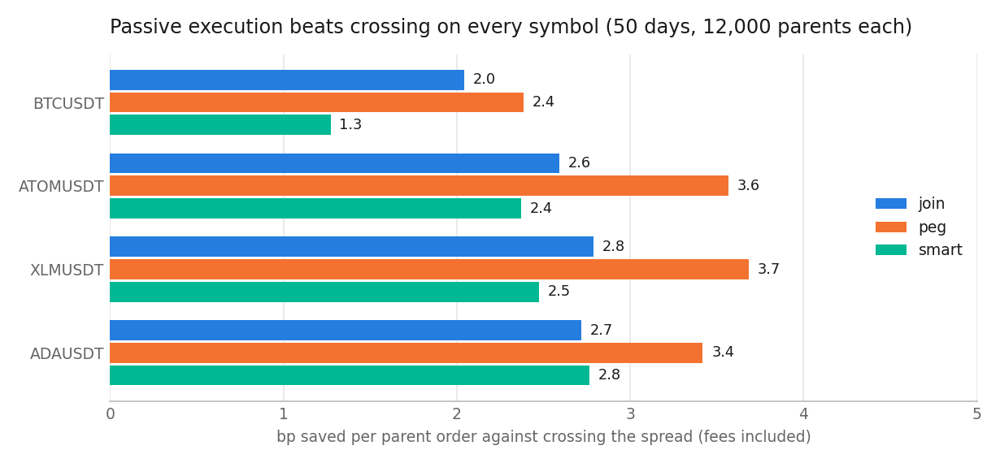
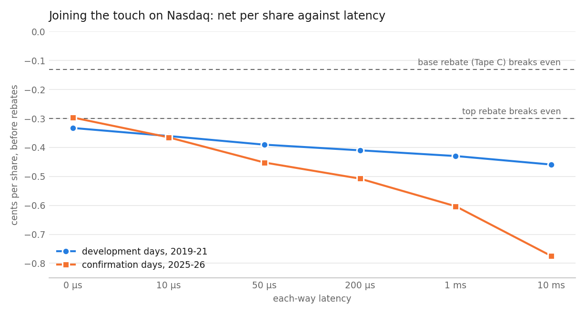

# lob-sim-cpp

[](https://github.com/saarthakg/lob-sim-cpp/actions/workflows/ci.yml)

A **C++ limit-order-book engine and backtester with exact queue priority**, a
Python API on top, and a research workflow built so it can't fool itself. It
runs entirely on free public data: Nasdaq's full order feed, Bybit perpetuals
and Bitstamp.

```python
import lobsim

r = lobsim.backtest("2019-12-30_INTC.l3bin.gz", "naive", quote_on_book=True, order_size=100,
                    max_position=500, latency_us=50, maker_fee_per_unit=-0.003, taker_fee_per_unit=0.003,
                    session_start="09:35:00", session_end="15:55:00")   # 801k events in about 0.3 s
r.summary["net_pnl"], r.fills["queue_ahead_at_entry"], r.equity["net_pnl"]
```

## Three results

### 1. Simulated fills match the real queue

Most backtesters guess where an order sits in the queue. On order-level data
this one puts it in the **real FIFO**. To check, a one-share simulated clone was
placed right behind each of 288,295 real Nasdaq orders. Price-time priority then
fixes when the clone may fill: never before the order ahead, never after the
next one behind.

| Model, on the same market | Impossible fills (jumped the queue) | Missed fills |
|---|---|---|
| **Exact-queue exchange** | **0 of 288,295** | **2 of 79,713**, both explained |
| Standard L2 queue model (Power-2) | 13,096 (4.5%) | 1,400 (1.8%) |
| L2, risk-averse | 735 (0.3%) | 11,410 (14.3%) |
| L2, log | 20,947 (7.3%) | 3,264 (4.1%) |

Orders that were cancelled are excluded, so the L2 rows are not unconditional
error rates. [Method and caveats](docs/engine.md#order-level-l3-engine).

### 2. Passive execution saves 1.6-3.7 bp, every day

48,000 paired parent orders, 50 days, four Bybit contracts, nothing fitted.
Pegging to the touch beat crossing the spread on **every day for every symbol**,
by 2.4-3.7 bp under the default fill model and 1.6-2.3 bp under the harshest
one. [Details](docs/results.md#3-taker-strategies-and-execution).



### 3. On Nasdaq, the maker rebate roughly equals adverse selection

Joining the touch with exact queue priority and zero latency nets about
0 c/share after Nasdaq's top rebate (0.30 c), in 2019-21 data and again in 2025-26 data.
Every step of latency costs more.



Five predictions were
[pre-registered](results/nasdaq/PREREGISTRATION.md) before the 2025-26 days
were downloaded:

| | Prediction | Verdict (threshold t = 3.0) |
|---|---|---|
| H1 | Touch-joining loses even at the top rebate, 50 µs | not supported (t = -2.20) |
| H2 | The best ladder makes money at the top rebate | not supported (lost on 8 of 8 days) |
| H3 | Gating on book imbalance makes fills *more* adverse | **supported** (t = -4.84) |
| H4 | 10 µs beats 10 ms | not supported (t = +2.69) |
| H5 | Touch-joining is near zero-profit at zero latency | **supported** (+0.004 c/share) |

H3 and H5 hold under [all four combinations](results/nasdaq/ROBUSTNESS.md) of
the simulator's impact and fill assumptions. Dollar totals are not quoted: the
simulated strategy trades 21% of market volume, more than a real one could
without moving prices. [Full study](docs/results.md#4-nasdaq-market-making-with-exact-queue-priority).

### What didn't work

- **No market-making strategy here is profitable** out of sample, on any venue
  or fee tier tested.
- **Smarter quoting mostly meant quoting less.** GLFT and the ladder cut losses
  77-100% against naive quoting, but cut volume 86-99.7%. Gross PnL per dollar traded
  improved in only 11 of 21 comparisons.
- **A promising pattern** (wide-quote GLFT, t = 2.3 over 16 days) **failed** its
  [pre-registered test](results/confirmation/CONFIRMATION.md) on 30 new days (t = 0.31).
- **Earlier versions of this README were wrong** about market-making profits and
  over-claimed twice more. [What changed and why](docs/results.md#what-changed-and-why).

## Engine

| | |
|---|---|
| **Order book** | Order-level book with price-time priority: **50M messages/s, 18 ns p50, about 50 ns p99** per operation (Apple M2 Pro), 5x a `std::map`/`std::list` book. Pooled orders in intrusive FIFOs, open-addressing id map, bitmap price ladder. |
| **Nasdaq ITCH 5.0** | Zero-copy, bounds-checked, fuzzed decoder. A full day (268.7M messages, 8,892 books) rebuilds in 22 s of compute with no inconsistencies. |
| **Exchange simulation** | Real FIFO on order-level data, a calibrated queue model on L2. Separate feed, entry and response latency, so stale quotes get picked off. Per-share or bp fees, sessions, post-only/GTC/IOC/market, optional volume-displacement impact. |
| **Live** | The same strategies paper-trade Bybit's real-time feed through a lock-free ring: **8.2 µs p50, 22 µs p99** tick-to-trade on a laptop. |
| **Testing** | 117 C++ test cases including randomized differential tests against a reference book, 11 Python tests (a Python strategy must reproduce its C++ twin fill for fill), ASan, UBSan, TSan and libFuzzer in CI. |

More in [docs/engine.md](docs/engine.md).

## Get started

**Python** (Python 3.9+, a C++17 compiler):

```bash
pip install .
python -m pytest python/tests        # after: pip install pytest
```

Then open [examples/quickstart.ipynb](examples/quickstart.ipynb): a backtest,
fill attribution, a latency sweep, and a strategy written in Python.

```python
class Join(lobsim.Strategy):                       # prices in ticks, sizes in lots
    def on_book(self, ctx):
        touch = ctx.best_bid[0]
        for i, o in ctx.orders.items():
            if o["price"] != touch and not o["cancel_sent"]:
                ctx.cancel(i)
        if not ctx.orders and ctx.position < 500:
            ctx.limit("buy", touch, 100)
```

**Command line**:

```bash
cmake -B build -DCMAKE_BUILD_TYPE=Release -G Ninja && cmake --build build -j
./build/lob_tests && ./build/lob_bench_l3
./build/lob_sim --help

# one Nasdaq stock-day: streams about 3.5 GB, keeps about 7 MB
python3 python/data/fetch_itch.py --days 2019-12-30 --symbols INTC
./build/lob_sim --replay data/processed/itch_l3/2019-12-30_INTC.l3bin.gz --strategy naive --quote-on-book \
                --order-size 100 --max-position 500 --latency-us 50 --maker-fee-per-unit -0.0030 \
                --taker-fee-per-unit 0.0030 --session-start 09:35:00 --session-end 15:55:00 --output out/intc

# one Bybit day, and live paper trading (no account or keys)
python3 -m venv python/.venv && python/.venv/bin/pip install -r python/requirements.txt
python/.venv/bin/python python/data/download_bybit.py --symbol BTCUSDT --start 2026-10-03 --end 2026-10-03
./build/lob_sim --live bybit --symbol BTCUSDT --minutes 10 --strategy naive --quote-on-book
```

On macOS with a broken system toolchain, build with Homebrew LLVM by setting
`CMAKE_CXX_COMPILER`.

## Documentation

| | |
|---|---|
| [docs/results.md](docs/results.md) | Strategies, research workflow, every result, what failed, limitations |
| [docs/engine.md](docs/engine.md) | Order book, ITCH, live runtime, how the simulator works |
| [docs/assumptions.md](docs/assumptions.md) | Exactly what the fill model assumes, and which way each choice biases results |
| [docs/architecture.md](docs/architecture.md) | Components, event ordering, threading |
| [docs/dataset.md](docs/dataset.md) | Data sources and formats |
| [docs/research_notes.md](docs/research_notes.md) | Literature notes |
| [results/](results) | Committed tables and pre-registrations |

```
cpp/        include, src: core/ marketdata/ sim/ strategy/ live/ util/     app/ (CLI)  bench/  fuzz/  tests/  python/ (bindings)
python/     lobsim/ (package)  data/ (downloaders)  analysis/  experiments/ (studies)  tests/
examples/   quickstart.ipynb
```

## Limitations

- **Impact is limited.** Optional volume displacement stops a share trading twice,
  but nobody reacts to our orders and prices don't move because of them.
- **Nasdaq results see one venue** and 18 free sample days. The national best bid
  and offer, and rebate eligibility, are not modelled.
- **On Bybit the book is conflated to 100 ms** and the queue is modelled.
- **Funding is not modelled,** and the sample covers few market regimes.

The [full list](docs/results.md#limitations) says more.

## Sources

The research notes ([docs/research_notes.md](docs/research_notes.md)) have the
full list with what was verified. Key references:

- Avellaneda & Stoikov (2008), *High-frequency trading in a limit order book*
- Guéant, Lehalle & Fernandez-Tapia (2013), *Dealing with the inventory risk* ([arXiv:1105.3115](https://arxiv.org/abs/1105.3115))
- Stoikov (2018), *The micro-price*; Cont, Kukanov & Stoikov (2014), *The price impact of order book events*
- Moallemi & Yuan, *A model for queue position valuation in a limit order book*
- [hftbacktest](https://github.com/nkaz001/hftbacktest): queue models, GLFT and OBI market-making tutorials
- [Bybit history data](https://www.bybit.com/derivatives/en/history-data), [public trades](https://public.bybit.com/trading/)
- [Bitstamp WebSocket API v2](https://www.bitstamp.net/websocket/v2/) (live_orders L3)

## License

MIT, see [LICENSE](LICENSE).
