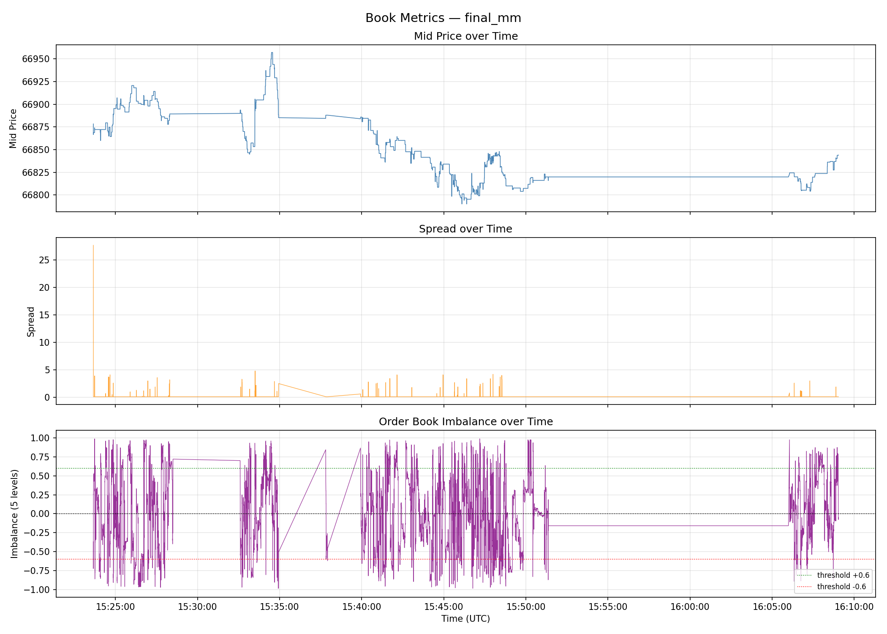
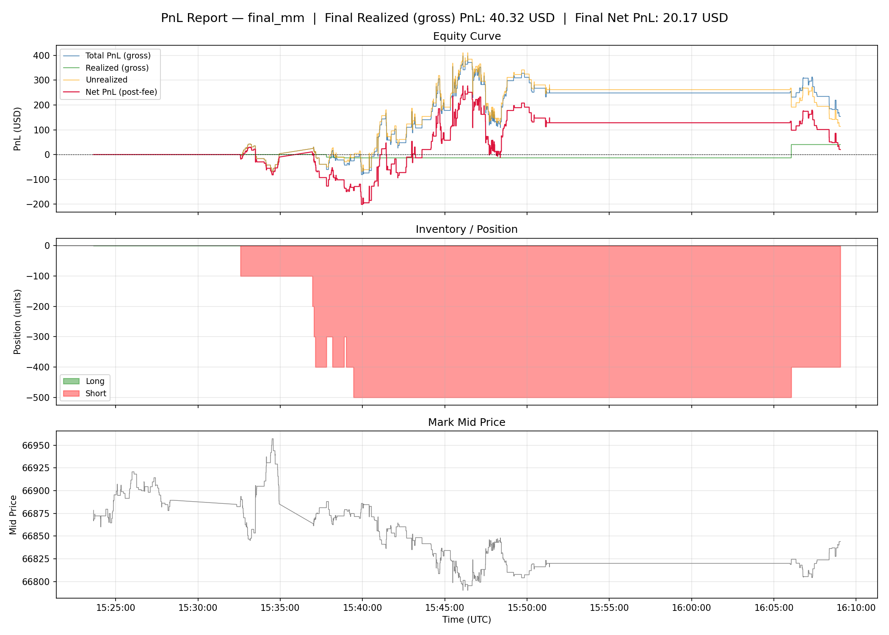
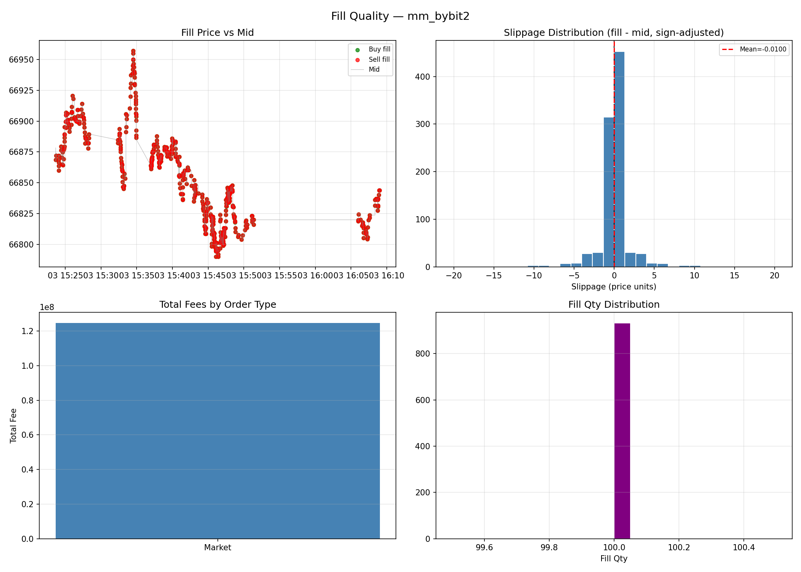
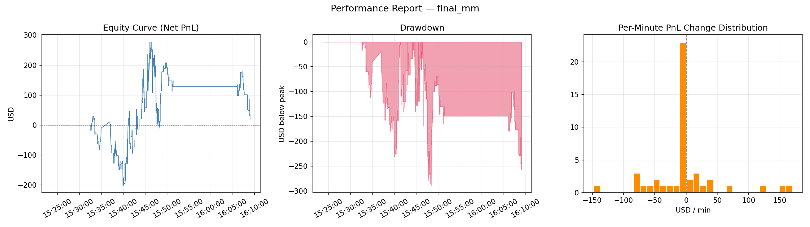

# lob-sim-cpp

A C++ event-driven **L2 limit order book replay and execution simulator** built around the Binance diff-depth WebSocket protocol, with live market data capture via Bybit.

---

## Features

- **L2 Order Book** — integer-tick `std::map<Price, Qty>` with O(log N) updates
- **Binance sync algorithm** — exact snapshot + diff-depth state machine per the official Binance docs
- **Live capture** — connects to Bybit WebSocket, syncs the book, records to normalized CSV
- **Replay engine** — reads normalized `depth_events.csv`, fires per-event callbacks
- **Execution simulator** — market orders walk the full visible book depth; passive limit orders approximate queue position from L2 data, filling only on activity at their own price level
- **Pre-trade risk controls** — self-crossing prevention and an optional max-position limit, both enforced at order entry
- **Latency model** — order arrival is genuinely delayed by `market_data_us + decision_us + order_entry_us`, matched against the book state as of arrival, not decision time
- **Three strategies** — Market Maker (tick-size-aware, inventory-skewed quoting), Imbalance (signal-triggered aggressive), and TWAP (scheduled slice execution)
- **Structured CSV exports** — `book_metrics.csv`, `fills.csv` (with a real `order_type` column), `pnl.csv`
- **Python analytics** — pandas + matplotlib scripts for PnL, fill quality, markout, latency sensitivity, and a Sharpe/drawdown/win-rate performance report
- **Unit tests** — Catch2, 154 assertions across 45 test cases
- **Benchmarked** — ~6.0M events/sec (book only, std::map), ~2.3M events/sec (with MarketMaker strategy)

---

## Quickstart

### Prerequisites

```bash
brew install cmake ninja       # macOS
# sudo apt install cmake ninja-build   # Ubuntu
```

Requires macOS with Xcode Command Line Tools, or Linux with GCC/Clang 14+.

### Build

```bash
git clone <repo>
cd lob-sim-cpp
cmake -B build -DCMAKE_BUILD_TYPE=Release -G Ninja
cmake --build build -j$(nproc)
```

### Run tests

```bash
./build/lob_tests
# All tests passed (166 assertions in 49 test cases)
```

### Synthetic demo

```bash
./build/lob_sim --synthetic-demo
```

### Capture live data and replay

```bash
# Capture 60 minutes of BTCUSDT from Bybit (US-accessible)
./build/lob_sim --live-capture BTCUSDT --exchange bybit \
    --output data/recorded/btc_live.csv --duration-minutes 60

# Replay with market maker strategy
./build/lob_sim --strategy mm \
    --replay data/recorded/btc_live.csv \
    --output data/processed/mm_run

# Analyze results
cd python && python -m venv .venv && source .venv/bin/activate
pip install -r requirements.txt
python analysis/plot_book_metrics.py    --run ../data/processed/mm_run --save
python analysis/pnl_report.py           --run ../data/processed/mm_run --save
python analysis/fill_quality.py         --run ../data/processed/mm_run --save
python analysis/markout_analysis.py     --run ../data/processed/mm_run --save
python analysis/performance_report.py   --run ../data/processed/mm_run --save
```

---

## CLI Reference

```
./lob_sim --synthetic-demo
./lob_sim --load-snapshot <path.json>
./lob_sim --replay <depth_events.csv>
./lob_sim --strategy mm        --replay <csv> [--output <dir>] [--latency-us <N>]
./lob_sim --strategy imbalance --replay <csv> [--output <dir>] [--latency-us <N>]
./lob_sim --strategy twap      --replay <csv> [--output <dir>] [--latency-us <N>]
./lob_sim --live-capture <SYMBOL> --exchange <bybit|binance> \
          --output <csv> [--duration-minutes <N>]
```

`--latency-us <N>` applies a fixed N-microsecond delay across the market-data, decision, and order-entry stages, modeled as a single combined order-arrival delay: an order submitted at time T isn't matched against the book until T + N, using the book as it exists at arrival — not at decision time. Use `python/experiments/latency_sweep.sh` to sweep latencies automatically.

---

## Results

### Benchmark Performance

Measured on Apple M-series, Release build (`-O3`), 1 million synthetic events (20 levels per side):

| Mode                            | Throughput        |
|---------------------------------|-------------------|
| Book-only replay (std::map)     | **6.0M events/s** |
| Book-only replay (sorted vector)| **8.8M events/s** |
| Replay + MarketMaker            | **2.3M events/s** |

Run `./build/lob_bench` to reproduce. See Key Finding 4 for context.

---

### Live Data Experiment

Two 60-minute sessions of BTCUSDT captured live from Bybit (USDT perpetuals, `orderbook.200`).

| Session | Events  | CSV size | Price range            |
|---------|---------|----------|------------------------|
| 1       | ~832K   | 49 MB    | —                      |
| 2       | ~753K   | 44 MB    | $66,790 – $66,957      |

**MarketMaker on Session 2 (14,933 replay events, `--strategy mm`, tick-size-aware quoting):**

| Metric               | Value                                     |
|----------------------|--------------------------------------------|
| Total fills          | 10 (3 buy / 7 sell) — 349 quotes cancelled |
| Gross PnL            | **+$153.90 USD** (realized $40.32 + unrealized $113.58) |
| Maker fees paid      | $133.74 USD (0.02% × ~$668.7K notional)    |
| **Net PnL after fees** | **+$20.17 USD**                          |
| Final position       | Short 4.00 BTC                             |
| Max drawdown (net)   | –$289.00                                   |

**ImbalanceStrategy on Session 2 (`--strategy imbalance`):**

| Metric              | Value                              |
|---------------------|------------------------------------|
| Total fills         | 1 (aggressive sell at $66,857.73)  |
| Gross PnL           | +$13.78 (unrealized; position not closed) |
| Taker fee paid      | $26.74 USD                         |
| Net PnL after fees  | –$12.96 USD                        |
| Final position      | Short 1 BTC                        |

The imbalance threshold (0.6) was breached only once in 14,933 events — consistent with
Bybit `orderbook.200` being a deep L2 feed where imbalance rarely reaches extremes.

**TWAP on Session 2 (`--strategy twap`, buy 100 units over 20 slices, 1s apart):**

| Metric              | Value                              |
|---------------------|------------------------------------|
| Total fills         | 20 (20 buy / 0 sell)               |
| Executed quantity   | 97.04 / 100.00 units (one slice partially filled — thin book) |
| Taker fees paid     | $2,595.85 USD                      |
| Net PnL after fees  | –$5,682.21 USD (unrealized; position never closed) |

TWAP is a scheduled *execution* algorithm, not an alpha strategy — it has no view on
whether $66,800 is a good price, so a large negative mark-to-market here just reflects
where the price happened to drift after accumulating a long position, not a strategy bug.

---

### Key Findings

**1. An unconditional fill check was letting orders fill on events that never touched their price — fixing it changed everything downstream.**
`ExchangeSim::advance_passive_orders` checked `qty_ahead <= 0` for every resting order on
*every* market event, even when that event never touched the order's own price level. A
freshly-quoted price (no prior displayed depth) starts with `qty_ahead == 0`, so under the
old code it filled on the very next *unrelated* tick anywhere in the book. In practice this
made MarketMaker's bid and ask fill *simultaneously* on almost every quote cycle — risk-free
spread capture that never actually held inventory (932 fills, always in same-millisecond
pairs, final position always flat). Gating the check on genuine activity at the order's exact
price dropped fills from 932 to 10 fills against 349 real cancellations, produced a real
short position, real drawdown, and real inventory risk — the honest picture an L2-only sim
can give. See [`docs/assumptions.md`](docs/assumptions.md), "Inside-Spread Quoting."

**2. Quoting must respect the venue's real tick size, not just the raw price precision.**
This project's Bybit BTCUSDT capture only ever shows resting depth on multiples of 10 raw
ticks ($0.10) — the venue's real minimum price increment is coarser than the $0.01 precision
the data format supports. A strategy quoting at an arbitrary raw tick (e.g. 1 tick inside a
10-tick-wide spread) lands on a price the market never trades at, so it can *never*
realistically fill under an honest L2 model. `MarketMaker::Config::quote_tick_size` snaps
quotes to the real grid; the CLI sets it to 10 for this project's captured data. A production
system would read this from the venue's exchange-info API instead of hardcoding it.

**3. Gross PnL isn't PnL — fees have to come out of the same number, not a side calculation.**
`Portfolio::realized_pnl()`/`total_pnl()` were (and remain) trading PnL only; fees were
deducted from `cash_` but never folded back into a "did we actually make money" figure — the
original version of this README computed "net PnL" by hand, outside the program. `Portfolio`
now tracks `total_fees_paid()` and exposes `net_pnl()` directly, and `pnl.csv` carries both.
MarketMaker on Session 2 is gross-profitable (+$153.90) and *still* net-profitable after fees
(+$20.17) — a much more interesting result than the old "gross profit, net loss by 3 orders of
magnitude" story, and only visible once fills stopped being risk-free freebies (Finding 1).

**4. Adverse selection is measurable via markout — but only once cancellations are filtered out.**
`fills.csv` is an execution-report log, not just fills — the 349 cancelled quotes above have
`fill_price == 0`, which is not a real price. `fill_quality.py` and `markout_analysis.py`
originally computed slippage/markout over *all* rows, so real cancellations (rare under the
old buggy fill model, common now) turned into fake giant-outlier "trades at $0." Both scripts
now load fills with `only_filled=True`. Run
`python analysis/markout_analysis.py --run data/processed/mm_bybit_fresh --save`
to compute markout at N = 10, 50, 100 events post-fill.

**5. Queue position approximation is a deliberate, still-present simplification.**
The L2 passive fill model (`qty_ahead` decrementation) still cannot see queue replenishment —
once a resting order's own price level is touched, it's treated as being at the front of any
size reduction there. This remains a genuine bias (direction depends on how much cancellation
vs. genuine trade-through activity dominates at a given level); it just no longer compounds
with the unconditional-check bug above. See [`docs/assumptions.md`](docs/assumptions.md).

**6. Flat vector outperforms std::map for shallow books; results flip at depth.**
At 20 levels per side (typical of many venues), the sorted-vector `OrderBookFlat` achieves
8.8M events/sec vs 6.0M for `std::map` — a ~47% throughput improvement from cache-friendly
contiguous memory. Bybit `orderbook.200` has up to 200 levels; at that depth the O(N) vector
shift overhead expected to negate the cache benefit. Run the benchmark with larger snapshots
to confirm empirically.

---

### Limitations

- **L2 data only** — no per-order queue visibility; passive fills use qty-ahead approximation, and only trigger on activity at their own exact price (see Key Finding 5)
- **No market impact** — strategy orders do not move the book (valid for small sizes)
- **Deterministic latency** — order arrival is now genuinely delayed (see Assumptions), but with a fixed offset, not a jitter distribution
- **Single symbol, single session** — results may not generalise across market regimes
- **Illustrative Sharpe ratios** — a ~45-minute session is far too short for a statistically meaningful annualized Sharpe; treat `performance_report.py`'s numbers as a relative comparison tool, not a live-performance claim

---

### Book Metrics



### PnL Report



### Fill Quality



### Performance Report



---

## Architecture

See [`docs/architecture.md`](docs/architecture.md) for a full component diagram and event flow.

```
LiveCapture → Recorder → depth_events.csv
                              │
                              ▼
ReplayEngine → BinanceDepthEvent → OrderBook → ExchangeSim → Strategy → Portfolio → CSV
```

The live capture flow (Bybit):
1. Subscribe to `orderbook.200.BTCUSDT` over WebSocket
2. Receive initial `type=snapshot` → load full book
3. Receive `type=delta` updates → apply incrementally, write to CSV

The live capture flow (Binance):
1. Open diff-depth WebSocket stream, buffer events
2. Fetch REST depth snapshot (`/api/v3/depth`)
3. Run `BookSync` state machine to find the first valid event
4. Apply subsequent events and write to CSV

> **Note:** Binance is geo-blocked for US users (HTTP 451). Use `--exchange bybit` (the default).

---

## Strategies

### MarketMaker
Quotes a bid and ask symmetrically around the mid price. Cancels and re-quotes when
the mid moves by more than 1 tick. Skews quotes toward reducing inventory when position
exceeds the configured limit (using real inventory units, not raw scaled quantity). Does
not quote when the book spread is unusually wide. Clamps price improvement over the real
best bid/ask to `target_half_spread_ticks` (so a wide book spread can't push quotes deep
inside it, onto a synthetic price nothing ever trades at), and snaps the final price to
`quote_tick_size` — the venue's real minimum price increment, which can be coarser than
the raw data's tick precision.

Key parameters: `target_half_spread_ticks`, `quote_size`, `max_inventory`, `skew_coefficient`, `quote_tick_size`.

### ImbalanceStrategy
Computes order book imbalance (bid qty − ask qty) / (bid qty + ask qty) over the top N levels.
Submits an aggressive market order when imbalance exceeds a configurable threshold.
Only trades when flat (no open position). Has a cooldown period after each trade.

Key parameters: `depth_levels`, `imbalance_threshold`, `order_size`, `cooldown_events`.

### TwapStrategy
A scheduled execution algorithm, not a signal-driven one: slices a total quantity into
`num_slices` equal child market orders, fired at fixed `interval_us` intervals starting
from the first event it sees. Deliberately indifferent to price — the standard baseline
for working a large order into the market with minimal signaling/impact.

Key parameters: `side`, `total_qty`, `num_slices`, `interval_us`.

---

## Assumptions

See [`docs/assumptions.md`](docs/assumptions.md) for a complete list. Key points:

- **L2 only** — no per-order queue visibility; we reconstruct a price → aggregate qty map
- **Passive fill approximation** — `qty_ahead` decremented as visible qty at a level shrinks, and only re-evaluated on activity at the order's own exact price (see assumptions doc)
- **Inside-spread quoting is bounded** — a strategy can improve on the real best bid/ask by at most a configured amount, and must snap to the venue's real tick size, or it quotes at a price nothing ever trades at
- **Market impact ignored** — our orders don't move the book (valid for small sizes)
- **Order-arrival latency is real** — `--latency-us` delays when a submitted order is matched against the book (to a later, possibly-moved book state), not just a pass-through config value
- **Pre-trade risk checks** — self-crossing prevention and an optional max-position limit, both enforced at order entry
- **PnL is reported both gross and net of fees** — `Portfolio::realized_pnl()`/`total_pnl()` are trading PnL only; `net_pnl()` subtracts cumulative fees

---

## Dataset

Live data is captured directly from Bybit's WebSocket stream using the `--live-capture` mode.
See [`docs/dataset.md`](docs/dataset.md) for details on the normalized CSV schema and conversion tools.

---

## Extensions

- [ ] L3 order-level simulation (requires ITCH or proprietary OMS feed)
- [ ] Multi-threaded engine with lock-free book updates
- [ ] Additional strategies — momentum, spread arbitrage (TWAP is done; see Strategies)
- [ ] Latency jitter — a log-normal distribution and co-location tiers, on top of the deterministic delay that's already modeled (see Assumptions)
- [ ] Parquet output for large-scale analysis
- [ ] Auto-detect venue tick size from exchange-info (`MarketMaker::Config::quote_tick_size` is hardcoded per-venue today)
- [ ] Trade-print (aggTrade) ingestion, so passive fills can be evidenced by real trades crossing a level instead of only by displayed-quantity changes
