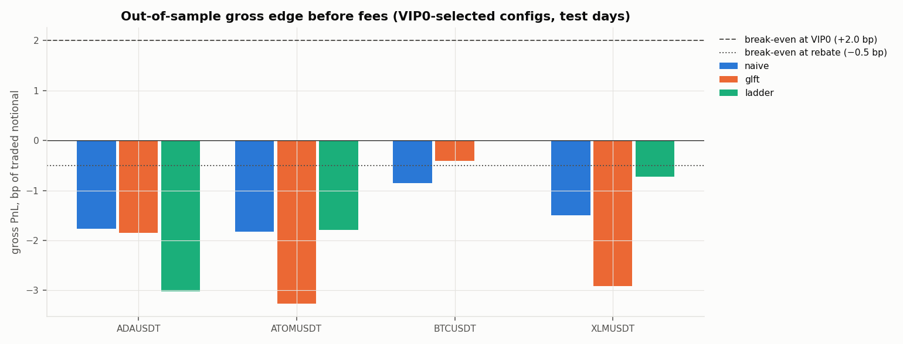
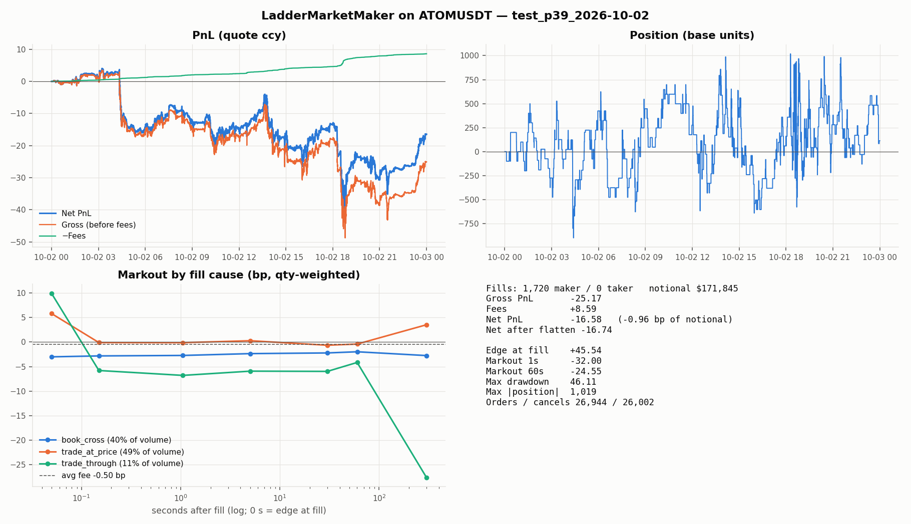
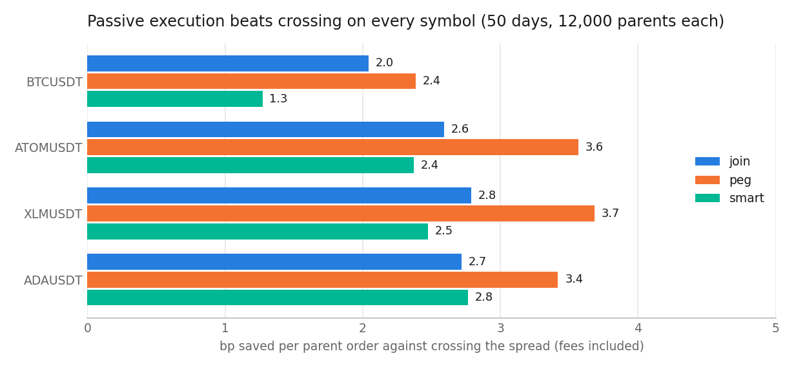
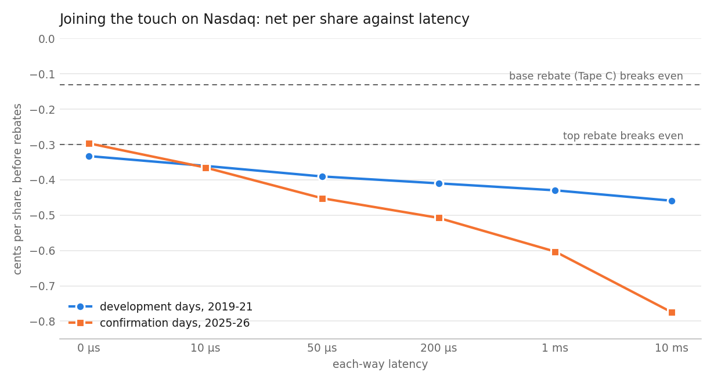

# Research: workflow, results and limitations

The full record behind the README summary: every table, what failed, and what changed.

## Strategies

| Strategy | Idea | Source |
|---|---|---|
| `naive` | Join the best bid and ask; stop at a position limit. The control. | — |
| `glft` | Closed-form optimal quotes with inventory skew. **σ** and fill intensity **λ(δ) = A·e^(−kδ)** are re-fitted every 5 s on a rolling 10-minute window of trades. The maker fee is added to quote depth. **Alpha:** an imbalance/microprice term shifts the fair price, with coefficients fitted on training days. Grid levels keep queue priority, and a depletion guard pulls a touch quote as soon as prints show its level being swept. | Guéant, Lehalle & Fernandez-Tapia (2013); hftbacktest GLFT and OBI tutorials; Stoikov (2018) |
| `ladder` | For **large-tick** books (spread pinned at 1 tick, tick ≫ fee). Rest a ladder from the touch to N ticks behind it so the orders hold queue priority when price arrives. Pull only the touch order, and only when the imbalance alpha or trade-driven depletion says the level is about to break. | Moallemi & Yuan (queue value); Cont, Kukanov & Stoikov (2014) |
| `imbalance` | Taker: cross the spread on extreme touch imbalance, exit after 5 s. Measures whether the signal can pay a taker fee. | Cont et al. (2014) |
| `twap` | Execute a parent order in time slices, either crossing each slice immediately or posting it passively and sweeping the remainder. | — |
| `probe` | Never-cancelled one-lot orders at scheduled points, used to score the fill model against L3 truth. | — |


## Research workflow

The process follows the [research notes](research_notes.md).

1. **Choose markets by arithmetic before backtesting.** `lob_sim --stats` across
   24 liquid Bybit perpetuals (2026-10-01):

   | Symbol | 1 tick | Spread − 2 × VIP0 maker fee |
   |---|---|---|
   | BTCUSDT | 0.012 bp | −3.99 bp |
   | ETHUSDT | 0.037 bp | −3.96 bp |
   | SOLUSDT | 0.85 bp | −3.15 bp |
   | **ADAUSDT** | **4.1 bp** | **+0.04 bp** |
   | **XLMUSDT** | **4.6 bp** | **+0.50 bp** |
   | **ATOMUSDT** | **5.9 bp** | **+2.02 bp** |

   On 21 of the 24 symbols, BTC and ETH included, a maker round trip at VIP0
   (2 bp + 2 bp) costs more than the quoted spread *before* any adverse
   selection. The study uses BTCUSDT, the most liquid control, and the three
   large-tick contracts.

2. **Fit signals out of sample.** `signal_research.py` regresses 1 s, 5 s and
   30 s mid moves on the weighted-mid offset and depth imbalance. Coefficients
   are fitted on days 1–4 and scored on days 5–8.

   | Symbol | OOS correlation with the 5 s move (4 test days) |
   |---|---|
   | BTCUSDT | 0.13 – 0.18 |
   | ATOMUSDT | 0.17 – 0.25 |
   | ADAUSDT | 0.15 – 0.29 |
   | XLMUSDT | 0.29 – 0.34 |

   The signal is real and stable. Its *size* is the issue: a fraction of a
   tick on large-tick books.

3. **Walk-forward.** For every symbol × strategy × maker-fee tier (+2.0 bp
   VIP0, 0 bp, −0.5 bp rebate):
   - **Grid-search** parameters on 4 training days (2026-09-28 → 10-01).
   - **Run** the selected parameters once on 4 untouched test days
     (10-02 → 10-05).
   - **Report** only test days. Training winners routinely decayed on test;
     for example, ATOM GLFT went from +$1.16/day on training to −$16.81/day
     on test.

4. **Stress the selection.** Latency from 0 to 200 ms; queue models
   RiskAverse and Log; the optimistic no-cross-fill bracket.

5. **Validate the fill model** against order-level ground truth
   ([Queue-model validation](#queue-model-validation)).

Reproduce everything:

```bash
python python/experiments/study.py              # ~45 min on 10 cores
python python/experiments/study.py --extended   # stage 2: grids extended where stage 1 hit a boundary
python python/experiments/summarize_study.py    # -> results/study/SUMMARY.md, docs/plots/study_*.png
```


## Results

All numbers are **out of sample**: Bybit USDT perpetuals, 4 test days,
parameters chosen on 4 earlier days. Order sizes are a few hundred dollars.
Full tables:
- [results/study/SUMMARY.md](../results/study/SUMMARY.md)
- [results/taker/SUMMARY.md](../results/taker/SUMMARY.md)

### 1. Market making: no configuration is reliably profitable at any fee tier

Selected configuration per cell. Net PnL is $/day averaged over test days;
**gross bp** is PnL before fees in bp of traded notional, which is also the
maker fee at which that configuration would break even.

| | VIP0 (+2 bp maker) | 0 bp | Rebate (−0.5 bp) | Gross bp (break-even fee) | Edge at fill → 5 s markout (bp) |
|---|---|---|---|---|---|
| BTCUSDT naive | −11,949 | −3,576 | −1,482 | −0.85 | −0.20 → −0.83 |
| BTCUSDT GLFT | −26 | −97 | −68 | −0.41 … −0.74 | +0.35 → −0.70 (rebate) |
| ATOMUSDT naive | −480 | −229 | −166 | −1.83 | −0.40 → −1.98 |
| ATOMUSDT GLFT | −17 | −11 | −11 | −2.1 … −3.3 | +4.1 → −2.2 (rebate) |
| ATOMUSDT ladder | −65 | −31 | −22 | −1.79 | +2.8 → −2.0 |
| XLMUSDT naive | −1,245 | −533 | −356 | −1.50 | −0.72 → −1.65 |
| XLMUSDT GLFT | −16 | −15 | **+1.5** (2/4 days) | −0.32 … −2.9 | +3.0 → −0.50 (rebate) |
| XLMUSDT ladder | −38 | −9 | −1.1 (2/4 days) | −0.57 … −0.73 | +2.0 → −0.36 |
| ADAUSDT naive | −1,638 | −769 | −552 | −1.77 | −0.54 → −1.80 |
| ADAUSDT GLFT | −47 | −42 | −37 | −1.65 … −2.4 | +2.0 → −2.0 (rebate) |
| ADAUSDT ladder | −249 | −149 | −125 | −3.01 | +0.55 → −1.92 |



**Stage 2: extending the grids where stage 1 hit a boundary.** GLFT always
picked the widest half-spread multiplier and the ladder the strongest alpha,
so both grids were extended (half-spread up to 8×, alpha up to 5×) under the
same split.

- **Training days improved.** The best wide-quote GLFT configurations earned
  +$15 to +$21/day on the training days.
- **Test days did not.** Daily test PnL is indistinguishable from zero:

  | Config (stage 2, selected on training days) | Test-day net PnL, $/day | Mean | t-stat |
  |---|---|---|---|
  | BTCUSDT GLFT, rebate, half-spread 8× | −15.8, +7.7, −2.7, +28.5 | +4.4 | 0.47 |
  | XLMUSDT GLFT, VIP0, half-spread 8× | +34.3, −4.8, −4.4, +9.4 (5–14 fills/day) | +8.7 | 0.94 |
  | ADAUSDT GLFT, rebate, half-spread 8× | −11.9, −3.9, −25.7, +76.0 | +8.6 | 0.38 |
  | ATOMUSDT GLFT, VIP0, half-spread 3× | −41.7, +37.8, −54.3, +25.1 | −8.3 | −0.36 |

- **Why:** quoting very wide means only being filled on overshoots. That is a
  low-frequency bet on short-term mean reversion, not market making. With so
  few fills, any single day is a coin flip.
- **More test days:** see [Pooled out-of-sample](#pooled-out-of-sample-16-days).

#### Pooled out-of-sample (16 days)

**Method.** Four test days can reject a strategy that loses every day. They
cannot tell a small edge from zero. So every selected GLFT and ladder
configuration was re-run, parameters frozen, on 12 more days that were never
used for selection (2026-09-16 → 09-27), and pooled with the 4 test days
([results/study/EXTRA_OOS.md](../results/study/EXTRA_OOS.md)).

**Ordinary market making is decisively negative.**

| Config | $/day | t-stat | Days > 0 |
|---|---|---|---|
| BTCUSDT GLFT, rebate | −77.5 | −10.7 | 0 of 16 |
| ATOMUSDT ladder, VIP0 | −86.1 | −8.0 | 0 of 16 |
| ADAUSDT ladder, VIP0 | −181.3 | −6.9 | 0 of 16 |
| XLMUSDT ladder, VIP0 | −62.1 | −3.1 | 4 of 16 |

Every touch-based configuration has a negative mean.

**Wide-quote GLFT is the one recurring positive.** These configurations quote
2–8× the GLFT half-spread and fill only on overshoots.

| Symbol | VIP0 $/day (t) | Rebate $/day (t) | Fills/day |
|---|---|---|---|
| ADAUSDT | +22.4 (t = 2.28, 69% of days) | +14.8 (t = 2.35) | 120–290 |
| ATOMUSDT | +2.9 (0.42) | +8.3 (1.22) | 170–340 |
| XLMUSDT | +7.8 (1.88) | +4.9 (0.75) | 19–1,100 |
| BTCUSDT | −1.7 (−0.43) | +1.2 (0.23) | 80–215 |

About 28 configurations were examined to get here, so one or two
|t| > 2 cells are expected by chance. The pattern is coherent and economically
plausible: providing liquidity only into dislocations earns a reversal
premium (Nagel 2012). But it is a *hypothesis*, so it got a pre-registered
test.

#### Pre-registered confirmation test (30 fresh days)

[results/PREREGISTRATION.md](../results/PREREGISTRATION.md) was committed and
pushed *before* the confirmation data was downloaded. It fixes:
- the eight configurations, with every parameter frozen;
- a 30-day window, 2026-08-17 → 09-15, never touched before;
- the pass/fail rules. The primary criterion is a daily ADA+ATOM+XLM
  portfolio at VIP0 with t > 2 and more than half of days positive. Any
  per-configuration claim needs t > 2.7 (Bonferroni).

**Result: H1 not supported**
([results/confirmation/CONFIRMATION.md](../results/confirmation/CONFIRMATION.md)).

| Pre-registered criterion | Mean $/day | t-stat | Days > 0 | Verdict |
|---|---|---|---|---|
| Primary: ADA+ATOM+XLM, VIP0 | +2.80 | +0.31 | 53% | not supported |
| Secondary: ADA+ATOM+XLM, rebate | −5.67 | −0.74 | 57% | not supported |

- **No single configuration came close to t > 2.7.** The best was ATOM at the
  rebate tier, t = +0.79.
- **ADAUSDT, the strongest candidate (t = 2.3 over 16 days), went to −$1.49/day
  (t = −0.17) on fresh data.**
- **What the wide-quote "edge" was:** selection noise across about 28
  configurations, exactly what the multiple-comparisons warning predicted.
  The pre-registration is what kept it from being reported as a result.

What the table shows:

- **Every gross bp is negative.** Every passive configuration on every symbol
  loses money *before fees* out of sample. The fee tier only decides how much
  more it loses. The one positive net cell, XLM GLFT with a rebate at
  +$1.5/day, is positive on 2 of 4 days and is noise.
- **The research ideas mostly reduce volume, not adverse selection.** ATOM
  losses fall from -$480/day (naive) to -$65/day (ladder) at VIP0, but volume
  falls 86% too, and gross PnL per dollar is unchanged (-1.83 vs -1.79 bp). Over
  all 21 symbol x strategy x fee cells, edge at the fill rises in every one;
  gross bp improves in 11, mainly for BTCUSDT and the XLM ladder, and it gets worse
  for the ADA ladder (-1.77 to -3.01) and every ATOM GLFT cell. An earlier version
  of this README presented the smaller dollar losses as the research features
  paying off.
- **None of it beats adverse selection.** Within 5 seconds the mid moves
  through the fill by more than the spread captured. A resting order mostly
  fills when the market is about to move through it, and that is the
  mechanism Glosten–Milgrom and Moallemi–Yuan describe.
- **BTCUSDT cannot work for a retail participant.**
  - The spread is 0.012 bp, so a quote earns essentially nothing by sitting at the touch.
  - GLFT's fee-aware quotes sit about 170 ticks out at VIP0 and only fill on large moves.
  - At the rebate tier it quotes at the touch and loses −0.74 bp gross.

  This matches the hftbacktest author's own caveat that their positive
  results come "mainly from rebates", and that edge decayed from 0.0139%
  per trade (2023) to 0.0044% (2025).

**One out-of-sample day, dissected** (ATOMUSDT ladder, rebate tier, 2026-10-02):



- **Fills at our price after the queue ahead is consumed** (49% of volume):
  +5.8 bp at the fill, about 0 bp within 1 s.
- **Fills where the level vanished and price crossed through the order**
  (40%): about −3 bp throughout.
- **Prints through the price** (11%): −5 to −7 bp.
- **Net:** the rebate (+$8.6) doesn't cover the −$25 gross.

### 2. The result is robust to latency and fill-model assumptions, except the queue model on large-tick books

Re-running the selected configurations on test days:

| | 0 ms → 200 ms latency (gross bp) | Optimistic (no cross-fills) | Queue: RiskAverse | Queue: Log |
|---|---|---|---|---|
| BTCUSDT GLFT, VIP0 | −0.41 → −0.96 | −0.47 | −0.41 | −0.41 |
| BTCUSDT GLFT, rebate | −0.74 → −0.79 | −0.80 | −0.76 | −0.70 |
| ATOMUSDT ladder, rebate | −1.79 → −2.07 | −1.85 | −2.01 | −0.46 |
| XLMUSDT ladder, rebate | −0.57 → −0.60 | −0.48 | −0.82 | **+2.00** (+$69/day) |
| ADAUSDT ladder, rebate | −3.01 → −1.92 | −3.15 | −3.42 | −2.27 |

- **BTC is negative under every assumption.**
- **On large-tick books the queue model decides the answer.**
  - The Log model credits a near-front order with a larger share of the
    cancellations ahead of it.
  - So the order reaches the front more often, and front-of-queue fills are
    the profitable ones.
  - Under Log, the XLM ladder makes +2.0 bp gross (+$69/day at the rebate
    tier), and +1.85 bp gross even at VIP0.
- **A result whose sign flips with an unobservable modelling choice is not an
  edge.** It is a hypothesis about queue dynamics, and the next section tests
  it directly. The answer: the Log model over-fills by 31% against
  order-level ground truth, so the positive Log-model results don't hold.

### Queue-model validation

L2 data cannot show where in a queue cancellations come from, but L3 data can.

**Capture.** `capture_bitstamp_l3.py` records Bitstamp's public order-level
feed for BTC/USD, ETH/USD and XRP/USD. Bitstamp is the only free
unauthenticated L3 feed we found: Coinbase `full` and LOBSTER samples now
require accounts.

**Ground truth.** `l3_ground_truth.py` places probe orders at the touch every
5 s and computes from exact order priority when each would truly have filled.

**Scoring.** `queue_model_validation.py` runs the *actual C++ fill model*,
under each queue model, on the 100 ms-conflated L2+trades view of the same
market and scores each model's fills against the truth.

**Data.** 150 minutes of BTC/USD, ETH/USD and XRP/USD: 3,598 probes per pair,
scored at 5, 15 and 60 s horizons
([results/queue_validation/VALIDATION.md](../results/queue_validation/VALIDATION.md)).

**BTC/USD is where the queue model matters**: 63% of true 60 s fills are
queue-driven, meaning prints at the probe's own price after the queue ahead
was consumed.

| Model (BTC/USD, 60 s) | Simulated fill rate (true: 0.305) | Accuracy | Precision |
|---|---|---|---|
| Exact-queue L3 exchange (order-level replay) | 0.300 | 0.996 | 1.000 |
| Power-2 (default) | 0.296 | 0.965 | 0.957 |
| Power-3 | 0.297 | 0.965 | 0.953 |
| RiskAverse | 0.277 | 0.972 | 1.000 |
| **Log** | **0.392 (+29%)** | **0.889** | **0.747** |
| Power-2 without cross-fills | 0.291 | 0.960 | 0.956 |

**On ETH/USD and XRP/USD** almost every true fill comes from price moving
through the probe. Every model scores 0.994–1.000 accuracy, *except* the
no-cross-fill variant, which misses 41–49% of real 60 s fills, and more at
shorter horizons.

Two conclusions:

1. **The Log queue model over-fills by about 29% against ground truth.** It
   was the only assumption under which the XLM and ATOM ladders turned
   positive in the sensitivity study, so that result is not credible. The
   default Power-2 model is well calibrated.
2. **Book-cross fills are real fills.** The "optimistic bracket" that drops
   them is simply wrong, which makes the default model's adverse cross-fills
   the realistic case, not a pessimistic one.

The caveat is that this is Bitstamp, not Bybit. Queue dynamics differ by
venue, and no public Bybit L3 feed exists.

### 3. Taker strategies and execution

**Imbalance taker.**
- On BTCUSDT the imbalance signal is genuine: crossing in its direction earns
  +0.24 to +0.28 bp gross per trade over the 4 test days.
- The taker fee is 5.5 bp, so the net is −5.2 bp.
- On ATOM, crossing a 5.9 bp tick costs more than the signal predicts.
- This is why the signal belongs inside a passive quoter, not a taker.

**Passive execution.** Each of 50 days is cut into 240 back-to-back 5-minute
parent orders (alternating buy and sell, 5 slices each), worked by four
algorithms on the same data: 12,000 paired parents per symbol. Nothing is
fitted. 5 ms each-way latency, VIP0 fees
([results/execution/EXECUTION.md](../results/execution/EXECUTION.md),
`python python/experiments/execution_study.py`).

| Saving against crossing (bp, fees included) | Join | Peg | Smart | Peg, pessimistic queue | Peg, prints only | Peg, both (lower bound) |
|---|---|---|---|---|---|---|
| BTCUSDT | +2.04 | **+2.38** | +1.27 | +2.30 | +2.35 | +2.25 |
| ATOMUSDT | +2.59 | **+3.56** | +2.37 | +3.48 | +1.99 | +1.64 |
| XLMUSDT | +2.79 | **+3.69** | +2.47 | +3.60 | +2.47 | +1.97 |
| ADAUSDT | +2.72 | **+3.42** | +2.77 | +3.32 | +2.55 | +2.12 |



- **Every passive algorithm beat crossing on every one of the 50 days, on every
  symbol,** and pegging did so under every fill assumption tested. Day-clustered
  t-statistics are 27 to 103.
- **Pegging is best**: follow the touch, then sweep what is left at the end of
  the slot. It fills 74-93% passively.
- **The imbalance signal did not help execution.** Crossing early when the book
  leans your way (Smart) improves the price but pays the taker fee more often.
- **Where the saving comes from.** On BTCUSDT pegging saves 3.3 bp of fees and
  gives back 0.9 bp of price. On the large-tick contracts it wins on both.
- **How much depends on the fill model.** Assuming cancellations ahead never help
  us ("pessimistic queue") costs under 0.1 bp. Dropping the rule that the
  opposite quote reaching our price fills us ("prints only") costs up to 1.6 bp
  on the large-tick contracts and nothing on BTC. Under both, the saving is
  1.6-2.3 bp. Removing liquidity that has already printed between book updates
  (`--consume-prints`) moves every figure by 0.06 bp or less
  ([EXECUTION_CONSUMED.md](../results/execution/EXECUTION_CONSUMED.md)).

> An earlier version of this section reported a 1.8 bp saving from *four*
> executions, one per day, and called it robust. This study replaces it. The
> conclusion survived, the evidence did not.

This is the one robustly positive, actionable result here: **use limit orders
to *execute*, not to make markets**.

### 4. Nasdaq market making with exact queue priority

The Bybit study has three caveats: a 100 ms book, a modelled queue and an
assumed rebate. Nasdaq's order-level feed removes all three. The same
strategies run on 14 stocks with their orders in the real FIFO, microsecond
latency, Nasdaq's published per-share fees, and end-of-day flattening.

- **Development:** 10 days, 2019-01 to 2021-08, 24 ladder parameter sets plus a
  touch-joining control ([DEV_GRID.md](../results/nasdaq/DEV_GRID.md)).
- **Confirmation:** 8 days, 2025-12 to 2026-06, downloaded only after
  [five hypotheses and their thresholds](../results/nasdaq/PREREGISTRATION.md)
  were committed and pushed ([CONFIRMATION.md](../results/nasdaq/CONFIRMATION.md)).

| | Prediction | Result (8 days) | t | Verdict (threshold t = 3.0) |
|---|---|---|---|---|
| H1 | Touch-joining loses even at the top rebate, 50 µs | loses on 7 of 8 days | -2.20 | not supported |
| H2 | The best ladder makes money at the top rebate | loses on 8 of 8 days | -2.03 | not supported (as expected) |
| H3 | Gating on imbalance makes fills *more* adverse | -0.24 c/share, 8 of 8 days | -4.84 | **supported** |
| H4 | 10 µs beats 10 ms | +0.53 c/share, 8 of 8 days | +2.69 | not supported |
| H5 | Touch-joining is near zero-profit at 0 µs | +0.004 c/share, band ±0.10 | - | **supported** |



- **The rebate prices adverse selection.** With no latency at all, joining the
  touch loses 0.30-0.33 c/share before rebates in both periods, and Nasdaq's
  top rebate is 0.30. That is the Glosten-Milgrom zero-profit condition, read
  off real order flow.
- **Latency is the rest of the story.** The loss grows at every step from 0 to
  10 ms in both periods. H4 had the predicted sign every day, but
  the effect was 0.04-0.22 c/share on the five December 2025 days and 1.0-1.4 on
  the three 2026 days. That spread keeps t below its threshold, so it counts as
  unconfirmed.
- **Filtering on imbalance backfires,** which is the one effect that clears its
  bar. A likely reason: it joins long queues at the back and gives up priority
  to cancel, so it fills mostly when a level is swept.
- **H1 is the same kind of near miss.** Losing on seven of eight days is not a
  confirmed loss when the sizes vary this much: one day (2026-06-12) made
  +$13.9k and one (2026-05-18) lost $90.2k.

**How much depends on the simulator's assumptions?** Two things the feed cannot
tell us are whether our fills should have taken volume from real makers, and
whether an order arriving at a price that crosses our quote would have traded
or was post-only. Both were bracketed *after* the verdicts were committed, on
the same days, so this is exploratory
([ROBUSTNESS.md](../results/nasdaq/ROBUSTNESS.md)). Verdicts stand on the first row.

| Impact | Cross-fills | Share of market volume, 50 µs | H1 t | H2 t | H3 c/share (t) | H4 c/share (t) | H5 c/share |
|---|---|---|---|---|---|---|---|
| none | on (study default) | 21% | -2.20 | -2.03 | -0.24 (-4.84) | +0.53 (+2.69) | +0.004 |
| none | off | 11% | -1.99 | -1.76 | -0.34 (-5.97) | +0.79 (+4.85) | -0.002 |
| displace | on | 20% | -1.92 | -2.17 | -0.31 (-6.39) | +0.55 (+2.65) | +0.017 |
| displace | off | 6% | -2.08 | -2.11 | -0.32 (-3.63) | +0.93 (+4.50) | -0.006 |

- **H3 and H5 hold under all four.** H1 and H2 miss under all four. H4 misses its
  threshold only when cross-fills are on.
- **The latency cost is not an artefact of the cross-fill rule.** That rule
  supplies 48% of fills at 50 µs (2% at zero latency), which looked like the
  explanation. Without it there are about half as many fills, and each one
  loses *more*.
- **Do not read the dollar totals.** The study-default control trades 21% of
  Nasdaq's printed volume on the confirmation days, 47% in QQQ
  ([PARTICIPATION.md](../results/nasdaq/PARTICIPATION.md)), far more than a real
  participant could without moving prices. No profit or loss is quoted from it.
- **H5 is volume-weighted:** 57% of its weight is QQQ and NVDA. By symbol it
  ranges from -0.51 (MU) to +0.10, median -0.05, with 10 of 14 within ±0.10. Zero latency is
  a limit, not a setting anyone can buy.

```bash
python python/data/fetch_itch.py                                 # streams 18 days (~150 GB of traffic, ~5 GB kept)
python python/experiments/nasdaq_study.py --stage dev
python python/experiments/nasdaq_study.py --stage confirm
python python/experiments/nasdaq_participation.py && python python/experiments/nasdaq_robustness.py
python python/experiments/nasdaq_plots.py
```

### 5. What it would take

Reading the break-even column together with the sensitivity runs, a passive
market maker on these contracts needs **at least one** of the following, by a
margin of about 1–3 bp:

- **Faster cancellation than the 100 ms public book allows.**
  - Bybit offers 10–20 ms books for top levels.
  - Professional makers react in microseconds.
  - The depletion guard, which reacts to individual prints, was picked by 19 of 21
    walk-forward selection, so faster reaction clearly pays.
- **A maker rebate deeper than −0.5 bp**, which means Bybit's market-maker
  programme with its volume obligations.
- **Validated front-of-queue priority**, as in the Log-model scenario, which
  in practice means being early to every new level.


## What changed and why

The original simulator's headline numbers were artifacts. In order of impact:

| Problem | Effect | Fix |
|---|---|---|
| Passive fill rule only fired when the level qty went *up* at a fresh price, and cancelled the order when its level emptied | Orders joining a real queue could never fill; "fills" were noise | Trade-driven fills, a queue model and partial fills ([assumptions](assumptions.md)) |
| No trade data at all | No execution evidence; fills inferred from depth only | Bybit trade prints merged in engine time |
| Live capture never recorded the initial snapshot | Every replay started from an empty book; the first state of the main session had a 277-tick spread | v2 capture with snapshots, trades and exact decimals |
| Binance `bookDepth` converted into "price levels" | It is ±1–5% cumulative depth sampled every 30–60 s, not an order book; `mm_btc_20240405` was meaningless | Converter deleted; Bybit's real L2 archive used instead |
| Quantities stored ×100 | 0.001 BTC levels rounded to zero | Integer lots from the detected lot size |
| Cancels were instantaneous; one combined latency | No stale-quote risk, the main cost of latency | Separate feed, entry and response channels; cancel-after-fill rejects |
| `ImbalanceStrategy` opened one position and never exited | One trade per session | Hold time and signal-flip exit |
| Reported PnL with one fill-model assumption, one session, in-sample | Unfalsifiable | Walk-forward over 8 days, three fee tiers, latency and queue sweeps, L3 validation |
| "Passive TWAP beats aggressive, robustly" rested on four executions (found 2026-11) | Right sign, no evidence | 48,000 paired parents over 50 days, with a lower bound under the harshest fill model |
| "Research features cut losses 85-99%" compared dollar losses, not losses per dollar traded (2026-11) | Presented trading less as trading better | Per-notional comparison: gross bp improved in 11 of 21 cells |
| Queue model called "calibrated" from fill rates alone (2026-11) | Hid that it jumps real queues | 288,295 real Nasdaq orders: 4.5% of its fills are impossible; the exact-queue exchange has none |
| ITCH decoder read past short frames; mistyped options ignored; truncated archives looked like short days; decimal overflow (2026-11) | Silent wrong answers or undefined behaviour | Bounds checks, strict options, checked streams, saturating parser, fuzzing in CI |


## Limitations

- **On Bybit, fifty days and one market regime.** That is 8 selection/test days, 12
  pooled out-of-sample days and 30 confirmation days, all from August to
  October 2026. It is enough to reject the strategies here, but it is not a
  claim about every market regime.
- **Limited market impact.** By default our orders never change the replayed
  market. `--impact displace` (L3) makes each printed share trade once and
  leaves displaced makers in the queue, but nobody reacts to our orders and
  prices do not move because of them. The default is reasonable at a few hundred
  dollars per order on Bybit and is strained by the Nasdaq touch-joining control,
  which reaches 21% of volume.
- **On Bybit, the 100 ms book is a hard floor** on how fast a simulated strategy
  can see cancellations. (The Nasdaq study has no such floor.) Results are pessimistic for a truly low-latency participant,
  and the no-cross-fill bracket bounds that.
- **The −0.5 bp rebate is a scenario**, not a published Bybit rate.
  Programme terms are private.
- **Funding is not modelled.** Holding periods are seconds to minutes.
- **The L2 queue model is validated on Bitstamp and Nasdaq, not Bybit.** No public
  Bybit L3 feed exists, and queue dynamics differ by venue.
- **Nasdaq results see one venue.** Orders and quotes on other exchanges, and so
  the national best bid and offer, are invisible. Marks use Nasdaq's own book.
- **The Nasdaq fee schedule is today's, applied to every day.** Rebate tiers are
  assumed, not earned: the top tier needs roughly 1% of US volume.

